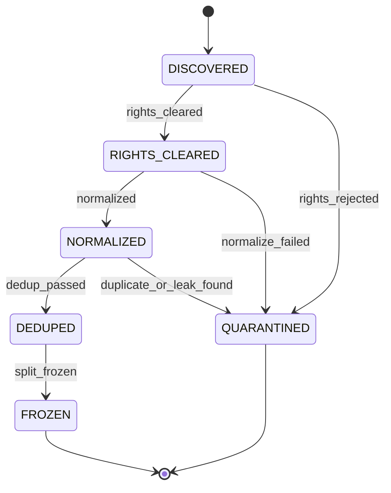

# Dataset lifecycle

Task T05 executes the two rights edges of the dataset machine in
[spec §7.1](../specs/001-faustcoder/spec.md). The table below is that
contract. Later edges are listed so a skipped rights check is rejected;
their effects belong to T06 and T07.

The implementation is `faustcoder/rights.py`. Receipts use the T02
artifact store and `transition-receipt.schema.json`. There is no
contract schema for `SourceRecord` or `RightsRecord`. `record_type` and
the `LicenseEvidence` payload are SPECULATIVE discriminators. They are
not a new contract.

## States and events

- Initial state: `DISCOVERED`.
- Final states: `FROZEN`, `QUARANTINED`.
- States: `DISCOVERED`, `RIGHTS_CLEARED`, `NORMALIZED`, `DEDUPED`, `FROZEN`, `QUARANTINED`.
- Events: `rights_cleared`, `rights_rejected`, `normalized`, `normalize_failed`, `dedup_passed`, `duplicate_or_leak_found`, `split_frozen`.
- T05 executes: `rights_cleared`, `rights_rejected`.

A transition requires license evidence. The evidence label must be
OBSERVED or INFERRED. A SPECULATIVE label is not evidence. An
unrecognized license stays `DISCOVERED` until a human decides.
STK-4.3 is allowlisted by D-013 and is not unrecognized. Program text
is not stored on the source, the evidence, the rights record, or the
receipt. A clearance binds the source to one unit on a cleared inventory row.
The source URL is a GitHub blob URL whose repo and commit equal the
row pin. The path, the function name on a library slice, and
`blob_sha` must equal that unit. The notice manifest must have the
same commit, path, function, and blob id. An inferred clearance names
a reviewer on the evidence or on that unit. The row reviewer does not
satisfy the check. Impulse-test paths cannot take `eval` or `holdout`.
The guard applies that rule to the source path.

## Transition table

| From | Event | Guard | To | Effect |
| --- | --- | --- | --- | --- |
| DISCOVERED | rights_cleared | RightsRecord shows license eligibility, attribution, and a notice row (R-002, R-014, D-013) | RIGHTS_CLEARED | Write RightsRecord; append receipt |
| DISCOVERED | rights_rejected | License ineligible, unknown or restricted (R-014) | QUARANTINED | Write exclusion receipt with reason; content not copied into any snapshot |
| RIGHTS_CLEARED | normalized | Deterministic transform succeeded | NORMALIZED | Write normalized Example as new node, parent = source; append receipt |
| RIGHTS_CLEARED | normalize_failed | Transform error (INFERRED) | QUARANTINED | Append receipt with diagnostics (INFERRED) |
| NORMALIZED | dedup_passed | No exact or near-duplicate family conflict; not in holdout family (R-003) | DEDUPED | Record duplicate-family id; append receipt |
| NORMALIZED | duplicate_or_leak_found | Duplicate or holdout-contamination match (R-003) | QUARANTINED | Append exclusion receipt naming the conflicting family |
| DEDUPED | split_frozen | SplitManifest assigns the item by project, near-duplicate family and provenance (R-003) | FROZEN | Write DatasetSnapshot and signed SplitManifest digests; append receipt |

Illegal transitions:

- `DISCOVERED` to `NORMALIZED`, `DEDUPED`, or `FROZEN`: the rights check is never skipped.
- Any event out of `FROZEN`. A removal is a new snapshot, not an edit.
- Any event out of `QUARANTINED`. Re-admission is a new `DISCOVERED` source.
- `rights_cleared` when the license is ineligible, unknown, restricted, or only SPECULATIVE.
- `rights_rejected` when the license is eligible. Refusal of an eligible license is a new source or a human decision, not this event.

The inventory of corpora is [rights-inventory.md](rights-inventory.md).

D-013 proposes, and does not implement, a memorization gate for T06 and
T07: an n-gram or AST near-duplicate filter on generated `.dsp` against
the training-only set. The threshold is not set. Exact content-hash
dedupe of vendored copies is already recorded on the rejected rows.
