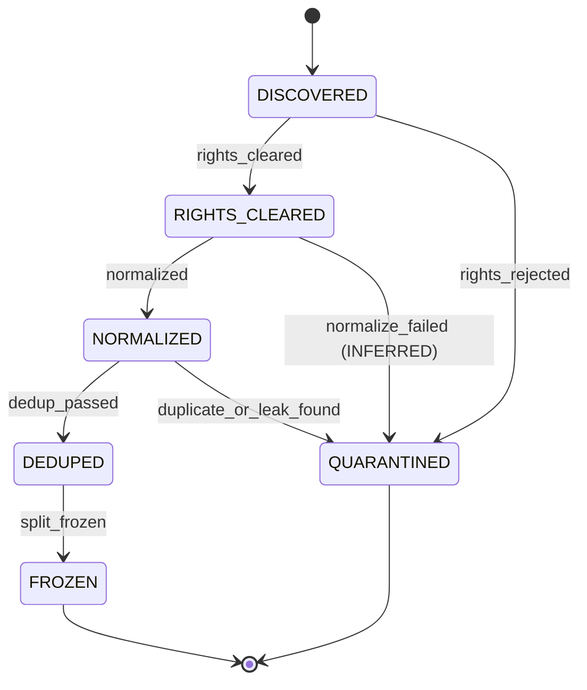

# Runbook: T06 normalization and dedup

T06 reads a T05 `rights-inventory.v1` document and a
`notice-manifest.v1` document, fetches each cleared file by git blob sha
at the pinned commit, normalizes the bytes, clusters exact and
near-duplicates, and writes a `DedupManifest` into the T02 artifact
store. The command is `faustcoder-snapshot`.

T06 does not clear rights. `rights_cleared` and `rights_rejected` are
T05 edges. Calling them on `faustcoder.dataset.apply_transition` raises
`TransitionNotImplemented` and writes nothing. Receipt envelopes from
this task use producer `faustcoder.snapshot`. T05 receipts use
`faustcoder.rights`. The snapshot actor is never stored as
`RightsRecord.reviewer`. The reviewer is the string on the T05 row, and
a cleared row with no reviewer is excluded as `needs-human`.

This runbook records the dataset machine from
[spec §7.1](../../specs/001-faustcoder/spec.md). T06 does not edit that
section. `split_frozen` stays unimplemented. T07 writes the
`DatasetSnapshot` and the signed split. Admission calls T05's
`guard_cleared_unit` and consumes
`corpus/rights-inventory.v1.json` and `corpus/notice-manifest.v1.json`
by content digest. `generated_at` is not part of that digest. The pins
are `sha256:e3938dd19b9456e94f563d446e4994fdd2d3d7f785e9599e02aabad6641c4f26`
and `sha256:bbda20fdef13092d010805aa2bc3df65f84250a9241de89292148fdb21b5f4ec`.
A unit is admitted only when it is a cleared T05 unit
`(repo, commit, path, function, blob_sha)`. Before normalization, the
snapshot hashes the ingested bytes with `git hash-object` and refuses
a mismatch with that `blob_sha`.

## States and events

- Initial state: `DISCOVERED`.
- Final states: `FROZEN`, `QUARANTINED`.
- States: `DISCOVERED`, `RIGHTS_CLEARED`, `NORMALIZED`, `DEDUPED`, `FROZEN`, `QUARANTINED`.
- Events: `rights_cleared`, `rights_rejected`, `normalized`, `normalize_failed` (INFERRED), `dedup_passed`, `duplicate_or_leak_found`, `split_frozen`.

| From | Event | Guard | To | Effect |
|---|---|---|---|---|
| DISCOVERED | rights_cleared | RightsRecord shows license eligibility and attribution (R-002, R-014) | RIGHTS_CLEARED | Write RightsRecord; append receipt |
| DISCOVERED | rights_rejected | License ineligible, unknown or restricted (R-014) | QUARANTINED | Write exclusion receipt with reason; content not copied into any snapshot |
| RIGHTS_CLEARED | normalized | Deterministic transform succeeded | NORMALIZED | Write normalized Example as new node, parent = source; append receipt |
| RIGHTS_CLEARED | normalize_failed | Transform error (INFERRED) | QUARANTINED | Append receipt with diagnostics (INFERRED) |
| NORMALIZED | dedup_passed | No exact or near-duplicate family conflict; not in holdout family (R-003) | DEDUPED | Record duplicate-family id; append receipt |
| NORMALIZED | duplicate_or_leak_found | Duplicate or holdout-contamination match (R-003) | QUARANTINED | Append exclusion receipt naming the conflicting family |
| DEDUPED | split_frozen | SplitManifest assigns the item by project, near-duplicate family and provenance (R-003) | FROZEN | Write DatasetSnapshot and signed SplitManifest digests (KANBAN T07); append receipt |

Illegal transitions:

- `DISCOVERED` to `NORMALIZED`, `DEDUPED` or `FROZEN`: the rights check is never skipped.
- Any transition out of `FROZEN`.
- `QUARANTINED` to any state.
- A holdout item moving into a training or development split.



T06 executes `normalized`, `normalize_failed`, `dedup_passed` and
`duplicate_or_leak_found`. It does not execute the two rights edges in
the table above. `faustcoder.dataset` requires a `rights_cleared`
receipt whose producer is `faustcoder.rights`, parented on a
`RightsRecord` from that same producer, before `normalized` or
`normalize_failed`. A receipt that only says `rights_cleared` and was
written by `faustcoder.snapshot` does not satisfy that guard.

The snapshot path does not call `apply_transition`. It treats the T05
inventory row as the clearance and records `inventory_digest` and
`notice_digest` on the manifest. Those digests drop `generated_at`.

Each T06 receipt's parents include the previous dataset receipt for
that source. The store therefore has one head, and `current_state` is
the `to` field of that head.

## Compiler gate (T03b)

T03b stages faustlibraries `2edec0537f53` (`version.lib` 2.80.0). See the
[compiler harness runbook](compiler-harness.md). This task still does
not compile-check the corpus:

- T06 does not compile-check corpus units.
- T06 does not read compiler receipts as a signal.
- T06 modules do not import `faustcoder.compiler` or `faustcoder.sandbox`.
- `--compile-check` defaults to off. Passing it raises `CompilerGateError`
  with the T03b message and returns exit code 2. The compiler is not called.

## What a unit is

T06 does not keep a `t06-inventory.v1` document. A unit is one T05 row
unit:

- one file, `{path, blob_sha}` with function `""`, or
- one function, `{path, blob_sha, function}`.

The whole blob is fetched. T05 function rows do not carry line ranges,
and this task does not slice `.lib` files (spec §4.2 forbids a Faust
parser). Slicing a function out of a multi-license library is a
follow-up. Until then a cleared function unit normalizes the whole
file, so a library file with more than one license collapses into one
family and is over-excluded rather than emitted in pieces.

If any non-cleared unit shares `(repo, commit, path, blob_sha)` with a
cleared unit, every cleared unit of that blob is excluded with reason
`needs-human`. That fails closed when an AGPL function sits in a file
that also has a cleared function. The blob is still fetched once, as a
comparison member, and is not stored.

A cleared unit also needs a `notice-manifest.v1` row at the same
commit, path, function and blob sha, whose license equals the entry
license. A miss is `notice-missing` and that cleared unit is not fetched.
`rights_rejected` and `needs_human` rows that name a blob are fetched,
hash-checked, and clustered. They are never emitted. A row that names
no files and no functions has no blob to compare, so it stays an
exclusion and is not fetched. Seven pinned rows are in that shape,
including `syfala-examples`.

## Exclusions carry a reason

The inventory reason is the T05 row's `reason` text, or the decision
word when the row has none. Family quarantine uses the short reason
`needs-human`.

A second check scans tokens after normalization. If the tokens contain
`ffunction`, the unit is excluded with reason `ffunction` and origin
`scan`. The text is not stored. This is a token backstop, not a
compiler check.

Other exclusion origins are `inventory`, `normalize` and `dedup`. A
normalize failure quarantines that unit and the run continues. A blob
mismatch, a mutable ref, or a short pin aborts the run. Nothing partial
is committed.

## Normalization

OBSERVED constraints: no custom Faust parser (spec §4.2); canonical JSON
does not Unicode-normalize.

INFERRED transform, applied in this order:

1. Reject a UTF-16 BOM and any NUL byte. Accept UTF-8 and strip one leading UTF-8 BOM.
2. Convert CRLF and a lone CR to LF.
3. Strip trailing U+0020 and U+0009 only.
4. Refuse a unit whose lines are all empty after that strip.

The original digest is SHA-256 of the fetched bytes. The normalized
digest is SHA-256 of the UTF-8 text that remains. Leading whitespace,
blank lines and a final LF stay.

## Near-duplicates

INFERRED, because spec §4.2 forbids a Faust parser, so this is not an
AST shingle:

- Strip `//` and `/* */` comments outside double-quoted strings.
- Tokenize identifiers, numbers and operators.
- Build a set of 5-token shingles.
- A pair is a near-duplicate when each side has at least 40 tokens and
  the Jaccard index is at least 4/5. The comparison is
  `intersection * 5 >= union * 4`.
- Texts under 40 tokens use a fallback, because a renamed short holdout
  would otherwise stay in training. Identical texts are not a
  near-duplicate here; the exact-hash pass owns those.
- When both sides have at least 32 non-space characters, character
  5-grams match at Jaccard 4/5 (`intersection * 5 >= union * 4`).
- Shorter texts match only when the identifier-and-number skeletons are
  equal and the character Jaccard is at least 1/3
  (`intersection * 3 >= union * 1`). The skeleton strips comments and
  whitespace, replaces quoted strings with `"s"`, identifiers with `id`
  and numbers with `n`. A one-digit edit of `process = os.osc(440);`
  matches. `process = fi.lowpass(2);` keeps the skeleton and stays under
  1/3, so it does not match. `process = no.noise;` has a different
  skeleton. (INFERRED thresholds. SPECULATIVE until a real corpus is
  used to tune them.)

The family id is `sha256:` of the canonical JSON array of the sorted
unique normalized digests in the component. It does not depend on unit
ids or comparison order.

Every member of a family, exact or near-duplicate, receives the
intersection of that family's `train` / `eval` / `redistribute` flags.
`rights_narrowed` is true when a member's admitted flags were wider.
A family whose license strings differ is not narrowed in place. Every
member is excluded with reason `needs-human` and origin `dedup`, and
the program text is not stored. A GPL training-only unit and a
one-token edit declared MIT therefore keep neither eval nor
redistribute.

The same quarantine applies when the GPL side was never cleared.
Rejected and `needs_human` blobs are comparison-only members of the
cluster. A cleared unit that joins one of those families is
`needs-human` with empty flags, which is also what the flag
intersection produces, because the non-cleared member contributes no
flags. The non-cleared text is not stored. Clustering is across repos,
so the 90 cleared faustplayground blobs are compared with every
rejected and `needs_human` blob that names a sha. Those playground
files are not in this repository, so CI does not byte-compare them.
The snapshot does, once the pinned commits are checked out.

Jaccard is symmetric, so a verbatim excerpt of a long rejected file
stays under 4/5. An excerpt check is asymmetric (INFERRED). It fires
when the cleared text has at least 40 tokens and either:

- `|shingles(cleared) ∩ shingles(non-cleared)| / |shingles(cleared)|`
  is at least 1/2 (`intersection * 2 >= |cleared shingles|`), or
- the two texts share a contiguous run of 40 normalized tokens.

The run counts when the cleared file is the longer one. A cleared file
that vendors an entire rejected blob and then adds its own padding is
`needs-human`. The upstream allowlist below, not a length comparison,
is what keeps an original that a later copy quotes.

The 40-token floor is policy. A cleared text under 40 tokens is not
an excerpt. A rejected blob under 40 tokens cannot supply a 40-token
run, so own code plus one rejected function shorter than 40 tokens
stays admitted. Containment uses the same floor on the cleared side.

On the pinned corpus, dropping the length guard newly quarantines 11
cleared STK examples. Each shares an 89-token `nonLinearity` block
with `needs_human` `NLFfm.dsp` (`faust-examples-copyright-only`),
which is shorter, so containment stays under 1/2. The files are
`bowed.dsp`, `flute.dsp`, `glassHarmonica.dsp`, `modalBar.dsp`,
`piano.dsp`, `piano1.dsp`, `saxophony.dsp`, `tibetanBowl.dsp`,
`tunedBar.dsp`, `uniBar.dsp` and `voiceForm.dsp`, all under
`examples/physicalModeling/faust-stk/`. The four syfala originals
are not in that set. `interpolators.lib` shares a 52-token series
with `signals.lib` and was already quarantined.

`faustplayground` `InstrReverb.dsp` is cleared LGPL-2.1 and is an
excerpt of rejected `instrReverb` in `faustlibraries-undeclared`
`instruments.lib`. The pair is `needs-human`. The playground bytes
used by the regression test are `tests/fixtures/t06/InstrReverb.dsp`
(blob `e38da4010e6abb85eadd02cecb60337798993194`). `instruments.lib`
is the pinned faustlibraries checkout, not a second copy in git.

## Upstream originals

Syfala has no file list, so its blobs are not fetched. Commit
`c893f4ce0d9aaf15d11dc9cf4d2abe67ea830c3f` on 2024-02-13 copied four
upstream files. If that row ever names blobs, those originals stay
cleared. The exception is an allowlist keyed by the upstream blob sha
in `faustcoder/upstream.py`, with the copy repo and path recorded
beside it. A family exempts that blob only when every non-cleared
member is that entry's `copy_repo` and `copy_path`. A near-duplicate
from any other repo is `needs-human`. It is not a date or similarity
heuristic.

| Upstream blob | Path | Syfala path |
|---|---|---|
| `e442c3d60a7bad0afa8de6bff4334923fbc627c0` | `grame-cncm/faustplayground` `public/faust-modules/combined/Birds.dsp` | `examples/faust/birds.dsp` |
| `ec6d4ffb0377f360d4a9c997df773865e22b1cc1` | `grame-cncm/faust` `examples/physicalModeling/old/harpe.dsp` | `examples/faust/harp.dsp` |
| `f14ca97f91375d8d84d59fd67564719e52124e8d` | `grame-cncm/faust` `examples/SAM/virtualAnalog/virtualAnalog.dsp` | `examples/faust/virtualAnalogForBrowser.dsp` |
| `33cbf6614a886e120b52d297b9a7868972741f9e` | `grame-cncm/faust` `examples/SAM/virtualAnalog/virtualAnalogForBrowser.dsp` | `examples/faust/virtualAnalogForBrowser.dsp` |

`virtualAnalog.dsp` and `virtualAnalogForBrowser.dsp` are the two SAM
files contained by the one syfala browser file. `tests/impulse-tests/dsp/harpe.dsp`
is a relative of `harpe.dsp` and is not on the allowlist. A listed
`blob_sha` is 40 lowercase hex characters, or 64 for sha256. The zero
id is rejected. A row with no file list still uses that placeholder
internally and is not fetched.

`memorization_hits` is the same comparison for T07 leakage checks and
the proposed output memorization gate. It does not write artifacts.

## Holdouts

A sealed holdout is a `{repo, commit, path, function}` passed beside
the inventory. It is fetched and compared in memory. Its text is not
stored. The manifest `sealed` list keeps the family id and the
normalized digest. An acquired unit in that family takes
`duplicate_or_leak_found` and is omitted from `example_digests`. The
short-text fallback above applies, so a one-token edit of a short
holdout is `holdout-family`.

`training_only` on the manifest is true when the effective flags are
exactly `train`. `impulse` is true when the path contains
`impulse-tests` or the entry id starts with `faust-impulse-`. Eval is
refused for that pair. A path that only contains the letters `impulse`
is not an impulse test and can keep eval. Those fields record the T05
row. They are not a second rights decision.

## Rights defaults (2026-10-17)

OBSERVED from the approved defaults and [ADR-0003](../adr/0003-licensing-and-data-rights.md):

- MIT, MIT-0, BSD-1/2/3/4-Clause, 0BSD, Apache-2.0, ISC, Unlicense, CC0-1.0, BSL-1.0, Zlib and STK-4.3: train, eval and redistribute, with NOTICE linkage.
- The exact string `BSD`: train and eval, no redistribution.
- GPL and LGPL spellings, including the Faust library exception: train only.
- AGPL, MPL-2.0, CC-BY-NC-SA-4.0, `unlicensed`, `unknown` and `NONE`: excluded.
- An unrecognized spelling is not guessed. T06 does not re-apply this
  table as an admission gate. The T05 row's `eligible_for` is what the
  snapshot admits, then family intersection can only remove flags.
- `INFERRED` clearances need a named reviewer. `SPECULATIVE` is refused.
- Header-less, in the defaults, means no license or copyright in a leading comment and no `declare *license*` or `declare *copyright*`. T06 does not infer a license from file text. The inventory names the license. (INFERRED boundary.)

Approval-note prefixes are not full commit hashes. T06 refuses a pin that is not 40 lowercase hex characters and does not expand those prefixes. (SPECULATIVE to treat a prefix as a commit.)

## Determinism

The manifest payload is a canonical function of the cleared units and the fetched bytes. `created_at` is not inside that payload. It is the envelope `created_at` and the receipt `timestamp`. `generated_at` is not in the content digest: `SourceRecord` has no `retrieved_at`. Re-signing an inventory, or the notice manifest, without changing entries keeps the same manifest digest.

Repeat a run with the same `--created-at` and the store writes identical envelope bytes. The second `put` is idempotent. A different `--created-at` keeps the same manifest content digest and is a `MutationError` in a store that already holds the first envelopes.

Shuffling entries does not change the digest. The content digest sorts entries, and units, exclusions and parents are sorted.

## Command

```text
faustcoder-snapshot \
  --inventory rights-inventory.v1.json \
  --notice notice-manifest.v1.json \
  --store receipts/local/t06 \
  --created-at 2026-10-17T20:00:00Z \
  --actor faustcoder-snapshot \
  --fetcher fixture \
  --fixture-root fixtures/t06
```

`--fetcher git` takes repeated `--git-root owner/name=/path/to/clone`.
`--fetcher github` reads `raw.githubusercontent.com` at the commit and
refuses redirects. Tests use the fixture fetcher or a stand-in opener.
CI does not call the network.

Exit codes: 0 stored the manifest and printed its content digest; 2
usage, inventory, policy, or the T03b compiler gate; 3 acquisition; 4
dataset or store refusal.

The manifest record type is `DedupManifest`, `lifecycle` is `DEDUPED`,
and `split_frozen` is false. Program text stays in the local `Example`
artifact. It is not a field of the manifest.

## Labels

- OBSERVED: the §7.1 table and diagram; T02 digest rules; ADR-0003; the 2026-10-17 defaults; spec §4.2 (no custom parser); `DatasetSnapshot` is the `split_frozen` effect; T03b stages faustlibraries `2edec0537f53` and T06 still does not compile-check corpus units; T05's inventory uses `rights_cleared`, `rights_rejected` and `needs_human`, with `files[]` or `functions[]` and a notice manifest keyed by commit, path, function and blob sha.
- INFERRED: T06 stops at `normalized` and admits through T05's guard against the pinned inventory and notice digests; `generated_at` is outside that digest; the ingested blob is hashed before normalization; a mixed-license family, and a family that contains a rejected or `needs_human` member, is `needs-human` rather than an intersection that still stores the text; a cleared excerpt of a non-cleared blob is `needs-human` at containment 1/2 or a 40-token run, including when the cleared file is longer and vendors the rejected blob; a rejected function under 40 tokens stays below that floor; the four syfala upstream originals stay cleared only when every non-cleared family member is that entry's recorded copy; a shared blob with any non-cleared unit is `needs-human` because function rows have no line range; character 5-gram Jaccard for texts under 40 tokens; the 32-character and 1/3 skeleton thresholds; `ffunction` as a token backstop; `DedupManifest` rather than `DatasetSnapshot`; receipt time is `--created-at`; the compiler flag refuses instead of compiling. Slicing `.lib` function units is a follow-up.
- SPECULATIVE: the 4/5 threshold, the 40-token floor, and the short-text 1/3 skeleton threshold need a real corpus before they are treated as tuned; full commit hashes are not in the approval note.
