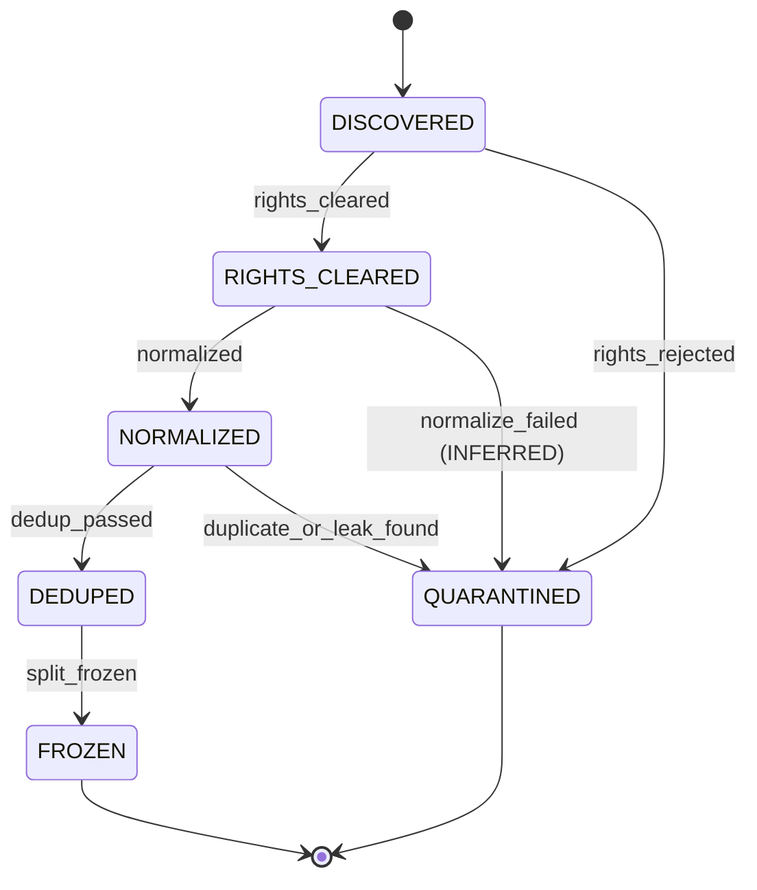

# Runbook: T06 normalization and dedup

T06 admits inventory units that are already rights-cleared or
training-only, fetches each file by git blob sha at a pinned commit,
normalizes the bytes, clusters exact and near-duplicates, and writes a
`DedupManifest` into the T02 artifact store. The command is
`faustcoder-snapshot`.

This runbook records the dataset machine from
[spec §7.1](../../specs/001-faustcoder/spec.md). T06 does not edit that
section. `split_frozen` stays unimplemented. T07 writes the
`DatasetSnapshot` and the signed split.

## States and events

- Initial state: `DISCOVERED`.
- Final states: `FROZEN`, `QUARANTINED`.
- States: `DISCOVERED`, `RIGHTS_CLEARED`, `NORMALIZED`, `DEDUPED`, `FROZEN`, `QUARANTINED`.
- Events: `rights_cleared`, `rights_rejected`, `normalized`, `normalize_failed` (INFERRED), `dedup_passed`, `duplicate_or_leak_found`, `split_frozen`.

| From | Event | Guard | To | Effect |
|---|---|---|---|---|
| DISCOVERED | rights_cleared | RightsRecord shows license eligibility and attribution (R-002, R-014) | RIGHTS_CLEARED | Write RightsRecord; append receipt |
| DISCOVERED | rights_rejected | License ineligible, unknown or restricted (R-014) | QUARANTINED | Write exclusion receipt with reason; content not copied into any snapshot |
| RIGHTS_CLEARED | normalized | Deterministic transform succeeded | NORMALIZED | Write normalized Example as new node, parent = source; append receipt |
| RIGHTS_CLEARED | normalize_failed | Transform error (INFERRED) | QUARANTINED | Append receipt with diagnostics (INFERRED) |
| NORMALIZED | dedup_passed | No exact or near-duplicate family conflict; not in holdout family (R-003) | DEDUPED | Record duplicate-family id; append receipt |
| NORMALIZED | duplicate_or_leak_found | Duplicate or holdout-contamination match (R-003) | QUARANTINED | Append exclusion receipt naming the conflicting family |
| DEDUPED | split_frozen | SplitManifest assigns the item by project, near-duplicate family and provenance (R-003) | FROZEN | Write DatasetSnapshot and signed SplitManifest digests (KANBAN T07); append receipt |

Illegal transitions:

- `DISCOVERED` to `NORMALIZED`, `DEDUPED` or `FROZEN`: the rights check is never skipped.
- Any transition out of `FROZEN`.
- `QUARANTINED` to any state.
- A holdout item moving into a training or development split.



`rights_cleared` in this task admits one inventory row. It does not
survey repositories and it does not import the T05 module. The
2026-10-17 rights defaults are applied before any fetch. An eligible
license cannot take `rights_rejected`. An ineligible license cannot
take `rights_cleared`.

## Compiler gate (T03b)

The T03 harness bundles faustlibraries `version.lib` 2.74.2. The corpus
pin is faustlibraries `2edec0537f53` (`version.lib` 2.80.0). See the
[compiler harness runbook](compiler-harness.md). T03b stages that pin
into the harness. Until it lands:

- T06 does not compile-check corpus units.
- T06 does not read compiler receipts as a signal.
- T06 modules do not import `faustcoder.compiler` or `faustcoder.sandbox`.
- `--compile-check` defaults to off. Passing it raises `CompilerGateError`
  with the T03b message and returns exit code 2. The compiler is not called.

## What a unit is

One inventory row is one unit:

- one file (`path` and `blob_sha`), or
- one function slice of one file (inclusive 1-based lines on the LF-normalized text), or
- one multi-file source: a primary `.dsp` plus sibling imports from the same directory.

Do not set both `path`/`blob_sha` and `files`. The primary is listed
first. Imports are sorted by path. A slice is allowed only when the
unit has exactly one file. A path that belongs to a multi-file unit
cannot appear in another unit.

The primary file must contain the quoted basename of each import, for
example `"helper.lib"`. A missing reference or an import in another
directory fails the run before a manifest is written.

The group stays one unit through normalization, near-duplicate
clustering and the manifest. A single file keeps that file's original
and normalized digests. A multi-file unit's digests are SHA-256 of the
canonical member list. Near-duplicate comparison sees the member texts
joined by a single LF, primary first.

## Exclusions carry a reason

`decision: reject` requires a reason code matching
`^[a-z][a-z0-9-]{1,40}$`. `ffunction` is the code for faust-stk files
that embed a foreign function. Those rows are not fetched.

A second check scans acquired and sealed-holdout tokens after
normalization. If any file's tokens contain `ffunction`, the whole unit
is excluded with reason `ffunction` and origin `scan`. No rights receipt
is written and the text is not stored. This is a token backstop, not a
compiler check.

Other exclusion origins are `inventory`, `normalize`, `dedup` and
`vendored`. A normalize failure quarantines that unit and the run
continues. A blob mismatch, a mutable ref, a short pin, or a notice
blob that does not contain the named copyright aborts the run. Nothing
partial is committed.

A sealed holdout that itself contains `ffunction` is excluded and is
not used as a leak source. (INFERRED.)

## Normalization

OBSERVED constraints: no custom Faust parser (spec §4.2); canonical JSON
does not Unicode-normalize.

INFERRED transform, applied in this order:

1. Reject a UTF-16 BOM and any NUL byte. Accept UTF-8 and strip one leading UTF-8 BOM.
2. Convert CRLF and a lone CR to LF.
3. Apply a function slice, if the inventory named one, on that LF text.
4. Strip trailing U+0020 and U+0009 only.
5. Refuse a unit whose lines are all empty after that strip.

The original digest is SHA-256 of the fetched bytes. The normalized
digest is SHA-256 of the UTF-8 text that remains. Leading whitespace,
blank lines and a final LF stay.

## Near-duplicates

INFERRED, because spec §4.2 forbids a Faust parser, so this is not an
AST shingle:

- Strip `//` and `/* */` comments outside double-quoted strings.
- Tokenize identifiers, numbers and operators.
- Build a set of 5-token shingles.
- A pair is a near-duplicate when each side has at least 40 tokens and
  the Jaccard index is at least 4/5. The comparison is
  `intersection * 5 >= union * 4`.
- Texts under 40 tokens are never near-duplicates. Exact normalized-hash
  equality still clusters them.

The family id is `sha256:` of the canonical JSON array of the sorted
unique normalized digests in the component. It does not depend on unit
ids or comparison order.

Exact-hash clusters narrow `eligible_for` to the intersection. The
strictest rights win, and `rights_narrowed` records that. Near-duplicate
pairs share a family id and do not narrow rights. (INFERRED.)

`memorization_hits` is the same comparison for T07 leakage checks and
the proposed output memorization gate. It does not write artifacts.

## Vendored copies and holdouts

A vendored row is fetched only to compare its normalized hash with the
named upstream unit. It is not a snapshot member. A match is recorded on
the upstream unit's `vendored_copies`. A mismatch is `vendored-stale`.
Vendored rows are never cleared on their own.

A sealed holdout is fetched and compared in memory. Its text is not
stored. The manifest `sealed` list keeps the family id and the
normalized digest. An acquired unit in that family takes
`duplicate_or_leak_found` and is omitted from `example_digests`.

Impulse units are training-only. They are never eval and never holdout.

## Rights defaults (2026-10-17)

OBSERVED from the approved defaults and [ADR-0003](../adr/0003-licensing-and-data-rights.md):

- MIT, MIT-0, BSD-1/2/3/4-Clause, 0BSD, Apache-2.0, ISC, Unlicense, CC0-1.0, BSL-1.0, Zlib and STK-4.3: train, eval and redistribute, with NOTICE linkage.
- The exact string `BSD`: train and eval, no redistribution.
- GPL and LGPL spellings, including the Faust library exception: train only.
- AGPL, MPL-2.0, CC-BY-NC-SA-4.0, `unlicensed`, `unknown` and `NONE`: excluded.
- An unrecognized spelling aborts the run. It is not guessed.
- `INFERRED` clearances need a named reviewer. `SPECULATIVE` is refused.
- Header-less, in the defaults, means no license or copyright in a leading comment and no `declare *license*` or `declare *copyright*`. T06 does not infer a license from file text. The inventory names the license. (INFERRED boundary.)

Approval-note prefixes are not full commit hashes. T06 refuses a pin that is not 40 lowercase hex characters and does not expand those prefixes. (SPECULATIVE to treat a prefix as a commit.)

## Determinism

The manifest payload is a canonical function of the inventory and the fetched bytes. `created_at` is not inside that payload. It is the envelope `created_at` and the receipt `timestamp`. `SourceRecord.retrieved_at` is the inventory `generated_at`.

Repeat a run with the same `--created-at` and the store writes identical envelope bytes. The second `put` is idempotent. A different `--created-at` keeps the same manifest content digest and is a `MutationError` in a store that already holds the first envelopes. Changing `generated_at` changes the digest, because it changes `retrieved_at`.

Shuffling the inventory units does not change the digest. Units, exclusions and parents are sorted.

## Command

```text
faustcoder-snapshot \
  --inventory inventory.json \
  --store receipts/local/t06 \
  --created-at 2026-10-17T20:00:00Z \
  --actor faustcoder-snapshot \
  --fetcher fixture \
  --fixture-root fixtures/t06
```

`--fetcher git` takes repeated `--git-root owner/name=/path/to/clone`.
`--fetcher github` reads `raw.githubusercontent.com` at the commit and
refuses redirects. Tests use the fixture fetcher or a stand-in opener.
CI does not call the network.

Exit codes: 0 stored the manifest and printed its content digest; 2
usage, inventory, policy, or the T03b compiler gate; 3 acquisition; 4
dataset or store refusal.

The manifest record type is `DedupManifest`, `lifecycle` is `DEDUPED`,
and `split_frozen` is false. Program text stays in the local `Example`
artifact. It is not a field of the manifest.

## Labels

- OBSERVED: the §7.1 table and diagram; T02 digest rules; ADR-0003; the 2026-10-17 defaults; spec §4.2 (no custom parser); `DatasetSnapshot` is the `split_frozen` effect; the T03 harness does not stage faustlibraries `2edec0537f53`.
- INFERRED: the `t06-inventory.v1` document (no schema on main, so no new contract file); token 5-gram Jaccard 4/5 with a 40-token floor; exact-cluster narrowing and near-dup non-narrowing; vendored rows hashed but not snapshotted; holdout text not persisted; the UTF-8 / LF / space-and-tab transform with no Unicode normalization; the 1 MiB cap; sibling imports as one unit; the quoted-basename import check; `ffunction` as a reason code and a token backstop; `DedupManifest` rather than `DatasetSnapshot`; unknown licenses abort; receipt time is `--created-at`; `retrieved_at` is inventory `generated_at`; the compiler flag refuses instead of compiling.
- SPECULATIVE: the 4/5 threshold and the 40-token floor need a real corpus before they are treated as tuned; function line ranges depend on a future inventory emitting them; full commit hashes are not in the approval note.
