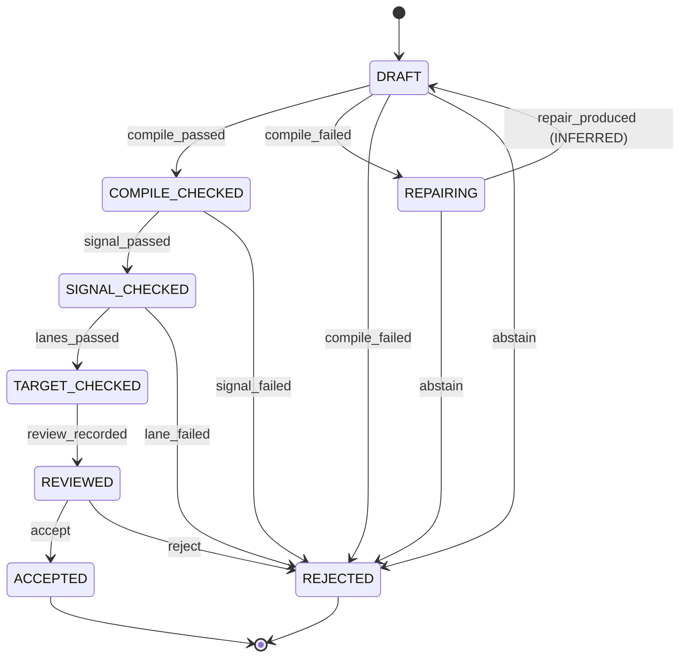

# Candidate machine

Contract: [spec §7.2](../../specs/001-faustcoder/spec.md).
Implementation: [`faustcoder/candidate_machine.py`](../../faustcoder/candidate_machine.py).
T04 persists the `signal_passed` and `signal_failed` effects
(a DSPTestReceipt). The other effects stay in the table so illegal
edges are rejected; later tasks write their artifacts.
`apply_signal` takes a `RewardableSignalReceipt` from
`grade_receipt` (spec §23 A5). The receipt must carry
`thresholds.reward_graded` and a profile digest in
`REWARD_PROFILES`. `nonlinear-suite-v1` is not in that
allowlist (D5, 2026-10-17). Diagnostic checks use
`apply_diagnostic_signal` and are not rewards.

Initial state: `DRAFT`.

Final states: `ACCEPTED`, `REJECTED`.

INFERRED states (spec §7.2): `REPAIRING`.

## States

| State | INFERRED |
|---|---|
| `DRAFT` | no |
| `COMPILE_CHECKED` | no |
| `SIGNAL_CHECKED` | no |
| `TARGET_CHECKED` | no |
| `REVIEWED` | no |
| `ACCEPTED` | no |
| `REJECTED` | no |
| `REPAIRING` | yes |

## Events

| Event |
|---|
| `compile_passed` |
| `compile_failed` |
| `repair_produced` |
| `abstain` |
| `signal_passed` |
| `signal_failed` |
| `lanes_passed` |
| `lane_failed` |
| `review_recorded` |
| `accept` |
| `reject` |

## Transition table

| From | Event | Guard | To | Effect |
|---|---|---|---|---|
| `DRAFT` | `compile_passed` | Sandboxed pinned compiler exit code 0 (R-005, R-013) | `COMPILE_CHECKED` | Write CompilerReceipt |
| `DRAFT` | `compile_failed` | `repair_attempts < max_repair_attempts` | `REPAIRING` | Write CompilerReceipt with diagnostics; increment `repair_attempts` |
| `DRAFT` | `compile_failed` | `repair_attempts >= max_repair_attempts` | `REJECTED` | Write CompilerReceipt; record abstention disposition (R-012) |
| `DRAFT` | `abstain` | Model or policy declines (R-012) | `REJECTED` | Record abstention disposition |
| `REPAIRING` | `repair_produced` | Repair output is a new CandidateProgram whose parent is the failed one (INFERRED) | `DRAFT` | New node; diff recorded for J-02 (INFERRED) |
| `REPAIRING` | `abstain` | Repair declined or produced no change (INFERRED) | `REJECTED` | Record abstention disposition |
| `COMPILE_CHECKED` | `signal_passed` | All signal tests in the TaskSpec `test_profile` pass: reference comparison, finite output, channel count, silence, DC and clipping (R-006, amended 0.3.0) | `SIGNAL_CHECKED` | Write DSPTestReceipt |
| `COMPILE_CHECKED` | `signal_failed` | Any required signal test fails | `REJECTED` | Write DSPTestReceipt with failing metrics |
| `SIGNAL_CHECKED` | `lanes_passed` | Every lane the TaskSpec `target` names passes (R-019, R-021 to R-024); none named for host-only tasks (ADD 0.3.0) | `TARGET_CHECKED` | Write one TargetReceipt per lane |
| `SIGNAL_CHECKED` | `lane_failed` | Any named lane fails (ADD 0.3.0) | `REJECTED` | Write the failing TargetReceipt |
| `TARGET_CHECKED` | `review_recorded` | Reviewer is independent of the generating model (R-011) | `REVIEWED` | Record review against gate results |
| `REVIEWED` | `accept` | All gates pass; for J-03, semantic and signal comparison against the baseline shows no regression and equivalence is evidenced | `ACCEPTED` | Write DecisionRecord (disposition = accepted) |
| `REVIEWED` | `reject` | Any gate fails, or J-03 equivalence is unproven | `REJECTED` | Write DecisionRecord (disposition = rejected, rationale) |

## Illegal transitions

- DRAFT -> SIGNAL_CHECKED: signal tests need a successful compile
- DRAFT -> REVIEWED: signal tests and review need a successful compile
- DRAFT -> ACCEPTED: signal tests and review need a successful compile
- COMPILE_CHECKED -> ACCEPTED: compilation alone is never acceptance
- SIGNAL_CHECKED -> REVIEWED: target lanes come first, even when the set is empty
- SIGNAL_CHECKED -> ACCEPTED without REVIEWED
- TARGET_CHECKED -> ACCEPTED without REVIEWED
- No transition out of ACCEPTED
- No transition out of REJECTED; a new attempt is a new node
- `compile_failed` -> `REPAIRING` when `repair_attempts >= max_repair_attempts`. The row selected is `REJECTED` (R-012). There is no unbounded repair loop.
- `review_recorded` or `accept` driven by the generating model's self-assessment (R-011). The `review_recorded` guard states this; the caller passes a failed guard.
- Rejecting a program only because its raw signal graph contains legal, delayed feedback (§4.2, ADR-0001). The signal harness has no such check.
- Any transition out of `ACCEPTED` or `REJECTED`. A new attempt is a new node.

## Diagram

