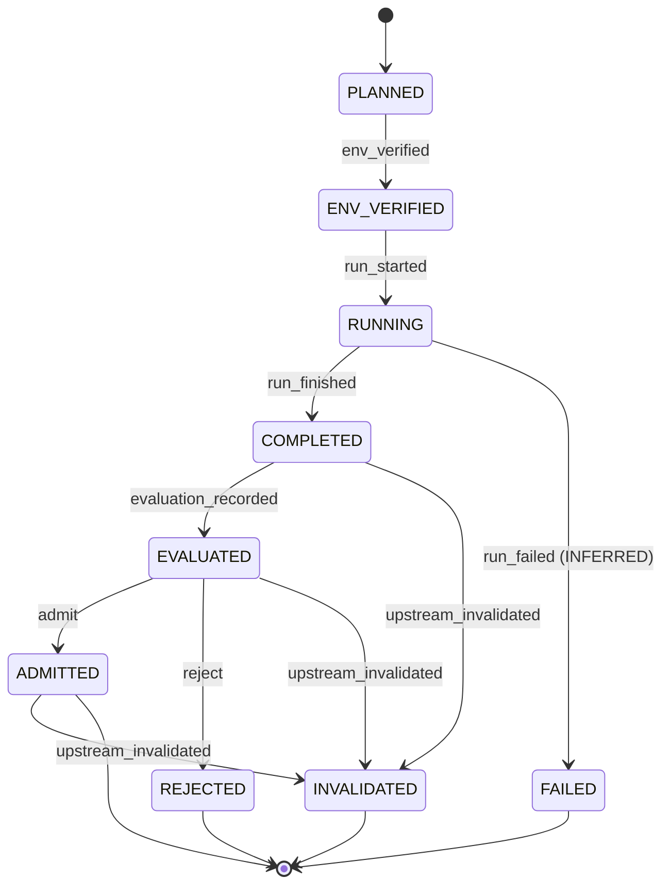

# Training machine

Contract: [spec §7.3](../../specs/001-faustcoder/spec.md).
Implementation: [`faustcoder/training_machine.py`](../../faustcoder/training_machine.py).
T09 persists the `env_verified` effect only. The other effects
stay in the table so illegal edges are rejected; T10 and later
tasks write their artifacts.

Initial state: `PLANNED`.

Final states: `ADMITTED`, `REJECTED`, `FAILED`, `INVALIDATED`.

INFERRED states (spec §7.3): `FAILED`, `INVALIDATED`.

## States

| State | INFERRED |
|---|---|
| `PLANNED` | no |
| `ENV_VERIFIED` | no |
| `RUNNING` | no |
| `COMPLETED` | no |
| `EVALUATED` | no |
| `ADMITTED` | no |
| `REJECTED` | no |
| `FAILED` | yes |
| `INVALIDATED` | yes |

## Events

| Event |
|---|
| `env_verified` |
| `run_started` |
| `run_finished` |
| `run_failed` |
| `evaluation_recorded` |
| `admit` |
| `reject` |
| `upstream_invalidated` |

## Transition table

| From | Event | Guard | To | Effect |
|---|---|---|---|---|
| `PLANNED` | `env_verified` | Pinned dependencies and hardware diagnostics recorded on DGX Spark (R-001) | `ENV_VERIFIED` | Record environment digest |
| `ENV_VERIFIED` | `run_started` | Dataset snapshot is `FROZEN`; split, config and code revision digests pinned (R-009) | `RUNNING` | Write TrainingRun with parents |
| `RUNNING` | `run_finished` | Training exited cleanly | `COMPLETED` | Record `checkpoint_digests` |
| `RUNNING` | `run_failed` | Crash, OOM or timeout (INFERRED) | `FAILED` | Append failure receipt; a retry is a new TrainingRun (§4.1) |
| `COMPLETED` | `evaluation_recorded` | Independent EvaluationRun on the development suite and sealed holdout (§9, R-011) | `EVALUATED` | Write EvaluationRun with paired comparison and confidence intervals |
| `EVALUATED` | `admit` | Gates met against the frozen baseline (D-005) | `ADMITTED` | Write DecisionRecord (admitted) |
| `EVALUATED` | `reject` | Gates not met | `REJECTED` | Write DecisionRecord (rejected) |
| `COMPLETED` | `upstream_invalidated` | An ancestor (dataset, split, base model, code) was invalidated | `INVALIDATED` | Mark dependent attestations invalid until rerun (INFERRED) |
| `EVALUATED` | `upstream_invalidated` | An ancestor (dataset, split, base model, code) was invalidated | `INVALIDATED` | Mark dependent attestations invalid until rerun (INFERRED) |
| `ADMITTED` | `upstream_invalidated` | An ancestor (dataset, split, base model, code) was invalidated | `INVALIDATED` | Mark dependent attestations invalid until rerun (INFERRED) |

## Illegal transitions

- PLANNED -> RUNNING: the environment is verified first (R-001)
- COMPLETED -> ADMITTED: admission needs an independent evaluation
- No edge out of REJECTED (spec §7.3)
- No edge out of FAILED (spec §7.3, INFERRED state)
- No edge out of INVALIDATED (spec §7.3, INFERRED state)
- Any transition out of REJECTED is forbidden; ADMITTED has no reject edge
- `run_started` on a dataset that is not `FROZEN`, or with any holdout item in the training data (§9). The `run_started` guard states this; T10 evaluates it.
- Overwriting a failed run's receipts on retry (§4.1). A retry is a new subject.

## Diagram

