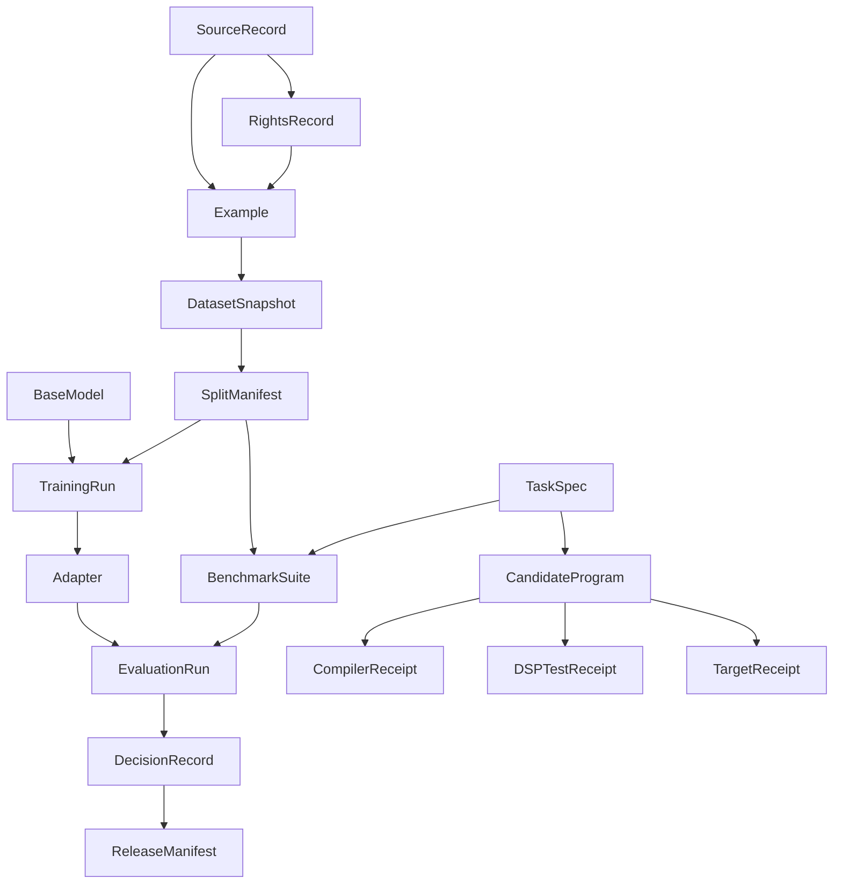

# Data model: FaustCoder (spec 001)

Entities come from spec §3. Fields come from spec §8 where listed; fields not in
the spec are labeled INFERRED. JSON Schemas live in [contracts/](contracts/).

## Common envelope

Every durable entity carries this envelope (OBSERVED §3):

| Field | Type | Notes |
|---|---|---|
| `schema_version` | string | SemVer of the schema |
| `artifact_id` | string | Stable id |
| `content_digest` | string | `sha256:<hex>` of the canonical payload |
| `created_at` | string | RFC 3339 timestamp |
| `producer` | string | Tool, person or run that produced it |
| `parents` | array of digests | Evidence DAG edges; must not form a cycle |
| `payload` | object | Immutable |

Model names and mutable aliases are never evidence (OBSERVED §3).

## Entities

| Entity | Purpose | Payload fields | State machine |
|---|---|---|---|
| SourceRecord | A discovered source of Faust code | INFERRED: `uri`, `retrieved_at`, `license_claim` | §7.1 |
| RightsRecord | License eligibility, attribution, retention | INFERRED: `license`, `eligible_for` (train, eval, redistribute), `attribution`, `reviewer` | — |
| Example | Normalized program and metadata | INFERRED: `source_digest`, `faust_source`, `duplicate_family` | §7.1 |
| DatasetSnapshot | Frozen set of examples | INFERRED: `example_digests` | §7.1 (`FROZEN`) |
| SplitManifest | Train, development and holdout assignment | INFERRED: `splits`, `grouping` (project, near-duplicate family, provenance per R-003), `signature` | — |
| TaskSpec | One benchmark task | OBSERVED §8 | — |
| CandidateProgram | A generated or repaired program | INFERRED: `task_id`, `faust_source`, `source_sha256`, `repair_attempt` | §7.2 |
| CompilerReceipt | Compile evidence | OBSERVED §8 (fields added 0.3.0) | — |
| DSPTestReceipt | Signal-test evidence | OBSERVED §8 (fields added 0.3.0) | — |
| TargetReceipt | Target-lane evidence (ADD 0.3.0, ADR-0004) | OBSERVED §8 | — |
| BenchmarkSuite | Frozen or development task set | INFERRED: `task_digests`, `kind` (frozen, development) | — |
| BaseModel | Upstream model reference | INFERRED: `name`, `revision`, `license` | — |
| Adapter | LoRA adapter or full weights (stored outside git) | INFERRED: `base_model_revision`, `weights_digest` | — |
| TrainingRun | One training attempt | OBSERVED §8 | §7.3 |
| EvaluationRun | Independent evaluation | INFERRED: `subject_digest`, `suite_digest`, `metrics`, `confidence_intervals` | — |
| DecisionRecord | Gate outcome | OBSERVED §8 | — |
| ReleaseManifest | Release bundle | INFERRED: the §15 evidence digests, `signature`, `rollback_artifact` | §7.4 |
| Receipt | Transition record | OBSERVED §7: actor, timestamp, input hashes, disposition | all |

## Relationships (evidence DAG)

Arrows point from parent to child. Validation rules (OBSERVED §3, §4.1,
ADR-0001): parents must exist before children; no cycles; a changed payload is
a new node.

## DSPTestReceipt metrics (INFERRED)

The accepted contract (spec §8) leaves `metrics` and `thresholds` as open
objects and does not name a frame count. T04 keeps that contract. The
harness puts the render length, the exact-compare head, stimulus names,
failure tokens, per-stimulus RMS, peak, NaN/Inf/denormal counts, spectral
bands, coarse block-RMS and band-energy gaps, the float32 sample
digest, the comparison window, and the `unshare` path and sha256 in
`metrics`. Thresholds record the gates that were enforced, including
the absolute tolerance and the relative term. `reward_graded` is
stored on every receipt, true or false, and is part of the
reproducible digest. A future grader and `apply_signal` must take
the receipt and require that bit true plus the canonical profile
digest (`test_suite_digest`). When the bit is true the signed sample
comparison covers the trimmed reference (`head_frames` equals that
length) and coarse checks cover only the samples past it. An impulse
reference whose `max_frames` is below the 144000 block-aligned cap
raises `ValueError`; the cap is not raised. `cpu_duration_ms`
is present only for a promotion candidate. The reference document is a
separate artifact (`kind = faustcoder.signal-reference`) whose content
digest is `reference_digest`. That document carries its own sample rate,
block size, frame count, seed and stimulus names, and its samples are the
1e-9 grid used for the comparison. None of this edits the accepted spec
text. A schema field for frames would be a Proposed amendment.

Reward use of these receipts is not wired. INFERRED: controls have to be
swept before a receipt is a reward, a reference-free DC or variance check
is never a reward, and wall-time CPU stays informational. See the signal
harness runbook.
