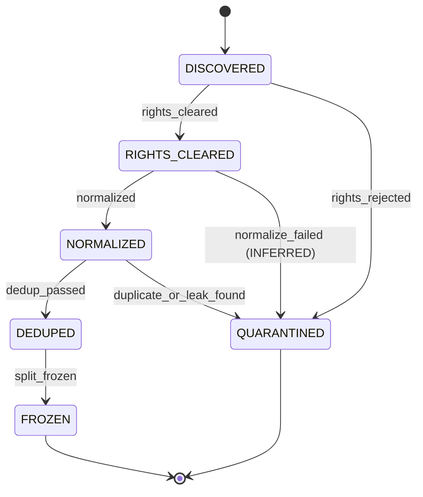
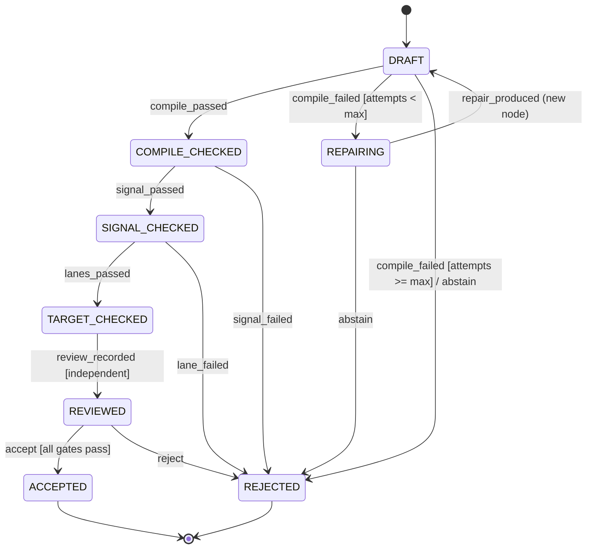
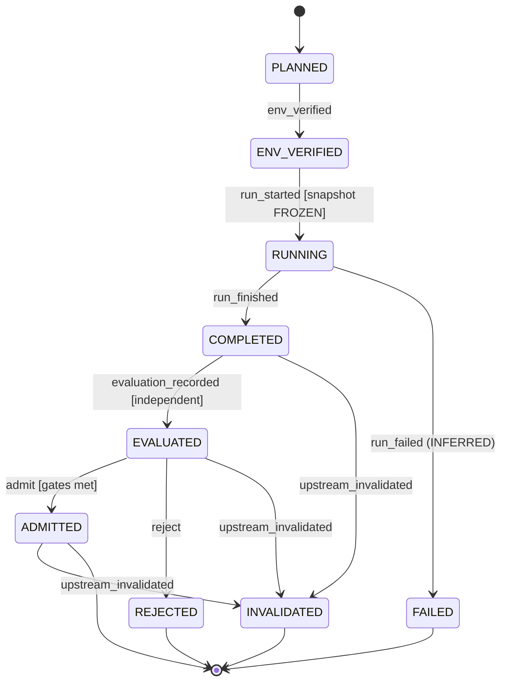
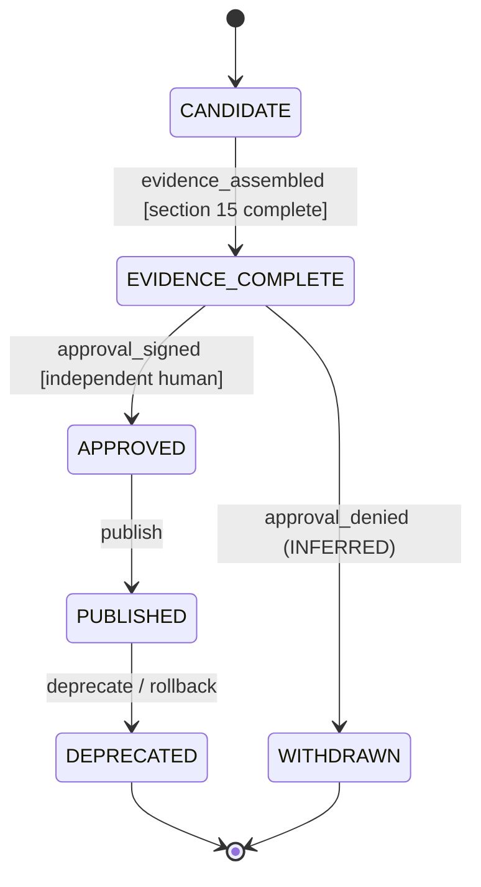

# FaustCoder: DAG-Compliant DSP Coding Model

- Status: DRAFT / refinement-ready
- Version: 0.3.0 (Faust-tooling assimilation and target lanes, ADR-0004; see §19). 0.2.0 training path: ADR-0002, §17
- Target: NVIDIA DGX Spark (128 GB unified memory)

## 1. Constitution

FaustCoder is a locally deployable model specialized in generating, repairing, explaining and optimizing Faust DSP programs. Correctness is evidence-based, not inferred from model confidence. No candidate may be promoted without independent compiler and signal-behavior evaluation. Preserve dataset licensing, reproducibility and explicit human approval for release. Do not treat a successful compilation as proof of audio correctness.

## 2. Scope

In scope: Faust source generation, repair, DSP design, optimization, documentation, benchmark harness, dataset pipeline, model adapters, local serving and IDE-facing API.

Out of scope (v1): general-purpose coding, autonomous plugin publishing, unrestricted internet ingestion, production audio mastering and claims of formal DSP verification.

Target classes (ADD 0.3.0, ADR-0004, Danny yes 2026-10-16 23:39 PT): the model writes Faust; Faust's own backends and `faust2*` scripts lower it to each target, and a verification lane per target class checks the result.

| Target class | Lane | First targets | Milestone |
|---|---|---|---|
| Host | wasm render (primary), native C++ cross-check | libfaust wasm, `-lang cpp` | V0.1 |
| Language backends | Compile the generated code in that language | `cpp`, `c`, `rust`, `cmajor` first | V0.3 |
| Plugins | `faust2*` build in a container, format validator, parameter-map check | CLAP, VST3, LV2 (Linux); AU deferred to macOS CI | V0.3 |
| Embedded | Per-board cross-compile, resource budget, real-time safety | Daisy, Teensy 4.x (D-008) | V0.3 |
| FPGA | Spike first; vendor-neutral Verilog via open toolchain | iCE40, ECP5 (D-009) | V0.5-FPGA |

Plugin distribution, code signing, notarization and store submission stay out of scope.

## 3. Domain model

Entities: SourceRecord, RightsRecord, Example, DatasetSnapshot, SplitManifest, TaskSpec, CandidateProgram, CompilerReceipt, DSPTestReceipt, BenchmarkSuite, BaseModel, Adapter, TrainingRun, EvaluationRun, DecisionRecord, ReleaseManifest.

All durable entities have schema_version, artifact_id, content_digest, created_at, producer, parents and immutable payload. Store lineage in a content-addressed artifact graph; model names and mutable aliases are not evidence.

## 4. Two DAGs

### 4.1 Evidence and execution DAG

source acquisition -> rights check -> normalization -> deduplication -> split freeze -> baseline -> training -> evaluation -> independent review -> release.

Each node references immutable parents. The graph must be acyclic; a new revision creates a new node, never rewrites ancestors. Invalidated ancestors invalidate dependent attestations until rerun. Execution orchestration may retry tasks, but retries create separate attempts and do not overwrite receipts.

### 4.2 DSP graph (REPLACED 0.3.0, ADR-0004 item 2)

The Faust compiler is the only parser. Graph and interface views come from its
own outputs: `-json` (UI, inputs, outputs, metadata), `-svg` block diagrams and
the compiler's signal-level output. FaustCoder does not build its own Faust
parser or typed signal-flow model. Feedback legality is whatever the compiler
accepts; a program is never rejected because its raw signal graph has cycles.
The superseded 0.2.0 text (custom typed signal-flow representation) is kept in
§19 for history.

## 5. Requirements

- R-001 (MODIFIED 0.3.0): Reproducible DGX Spark environment, pinned dependencies and hardware diagnostics. Toolchain pins follow the version set in ADR-0004 (Faust 2.88.0, a faustlibraries commit, faustwasm, target SDKs and validators); every receipt records the pin it used.
- R-002 (MODIFIED 0.3.0, D-007): Curated, license-traceable Faust corpus with source attribution and exclusion policy. License is resolved per function where a library file declares licenses per function, and per file otherwise; header-less example files inherit their repository's license.
- R-003: Contamination-resistant splits by project, near-duplicate family and provenance.
- R-004 (REPLACED 0.3.0): Task taxonomy has three axes: DSP category (the faustlibraries library split: oscillators, filters, envelopes, delays, reverbs, compressors and dynamics, noises, physical models, spatialization, analyzers, routing, misc effects and synths), task type (generate, repair, explain, optimize, remix) and target (host, language backend, plugin, embedded board, FPGA). Dev tasks are seeded from faustlibraries `#### Usage` blocks and tests; the sealed holdout is newly written (§9).
- R-005 (MODIFIED 0.3.0): The compiler harness runs libfaust from faustwasm in a sandboxed worker as the primary compiler and the native Faust 2.88.0 CLI for cross-checks (D-003r2). Receipts record backend, Faust version, options, exit status, classified diagnostics and source digest. The reward ladder is: parse error < type or arity error < compiles with warnings < compiles clean.
- R-006 (REPLACED 0.3.0): Signal tests render offline with faustwasm at fixed sample rate, block size and seed and compare against references in the style of Faust's impulse tests (`tests/impulse-tests`), plus finite-output, channel-count, silence, DC and clipping checks. CPU cost is measured only on promotion candidates and target lanes, not on every candidate.
- R-007 (amended 0.2.0, ADR-0002): Adapt an existing open base code model; never train from scratch. Baseline a 0.5B to 8B shortlist of Apache-2.0 base models (research.md) zero-shot and few-shot; choose the student by measured quality and Spark throughput, preferring the smallest model within the confidence interval of the best.
- R-008 (amended 0.2.0, ADR-0002): Method per phase: full-parameter continued pretraining for students up to about 4B, LoRA rank 64 to 256 (alpha = 2r) for SFT and for larger students. QLoRA is not needed at or below 8B on 128 GB.
- R-009: Immutable dataset/model/evaluation lineage and reproducible release manifest.
- R-010: Local inference API supports generate, repair, explain and optimize with structured responses.
- R-011: Independent evaluation cannot be satisfied by self-reported model judgments.
- R-012: Explicit abstention and bounded repair attempts; no unbounded compiler-agent loop.
- R-013 (MODIFIED 0.3.0): Security: sandboxed compiler and render workers (the wasm worker needs no host compiler or shell), containerized target toolchains with no network, resource limits, no arbitrary shell execution from generated code, and artifact integrity checks.
- R-014: Training/evaluation data governance includes license eligibility, attribution, retention and removal procedure.
- R-015 (amended 0.2.0, ADR-0002): Phase-gated training path P0 corpus and evaluation harness, P1 continued pretraining (skipped by rule when the cleared corpus is too small), P2 SFT, P3 compiler-feedback RL. Each phase has a timebox and an exit gate defined in ADR-0002.
- R-016 (amended 0.2.0, ADR-0002): Synthetic training data and RL rewards come only from the sandboxed compiler and signal tests (R-005, R-006, R-011). Signal tests must reject silence, DC, NaN/Inf and trivial programs so rewards cannot be gamed. (0.3.0) Target-lane results (R-019 to R-024) may also be rewards once their lane is in place.
- R-017 (ADD 0.3.0): SFT targets follow Faust house style: `import("stdfaust.lib");` and library prefixes (`os.`, `fi.`, `en.`), `declare` metadata (name, author, license, version), labeled UI primitives with units and ranges (`hslider`, `vslider`, `nentry`, `button`, `checkbox`, groups), and `process` as the entry point. A style check flags deviations; it is advisory, not a gate.
- R-018 (ADD 0.3.0): Upstream-validated pairs: faustlibraries `#### Usage` blocks and tests and the Faust examples become SFT pairs only after they compile and render in the harness. License follows R-002.
- R-019 (ADD 0.3.0, V0.3 gate, D-008): Embedded lane. A candidate for a board is reliable when it (1) builds with that board's `faust2*` script or SDK at the pinned version, (2) fits the board's flash and RAM budget from the linker map, (3) meets a CPU budget at the board's block size, measured in a cycle-accurate or host proxy until hardware exists, and (4) is real-time safe: no NaN/Inf or denormals in the render, no allocation in the audio callback, and memory placement declared with `-mem` where the board needs it. First boards: Daisy and Teensy 4.x.
- R-020 (ADD 0.3.0, V0.3 gate, D-010): Remix tasks combine techniques from two or more existing demos with one experimental idea. Correctness uses the normal gates; novelty (distance from the source demos in code and in rendered output features) is a dev metric, not a gate. faust-rs experimental primitives are out of scope.
- R-021 (ADD 0.3.0, V0.3 gate): Real-time safety checks apply on every target lane: finite output, no denormals (flush-to-zero honored), bounded delay-line memory and no allocation after init.
- R-022 (ADD 0.3.0, V0.5-FPGA, D-009): FPGA lane. Goal: synthesizable, pipelined Verilog for generic FPGAs. The model writes Faust; a vendor-neutral lowering produces Verilog. The path is chosen after the F0 spike (ADR-0004). Evidence: Verilator simulation matches the Faust reference render within a fixed-point tolerance, and Yosys plus nextpnr synthesize for iCE40 and ECP5 within resource limits. "Pipelined" means the design sustains one sample per channel at 48 kHz at the achieved clock.
- R-023 (ADD 0.3.0, D-012): Plugin lane. Build the candidate as a plugin in a container with the pinned `faust2*` script and SDK, run the format's validator (`clap-validator` for CLAP, `pluginval` for VST3, `lv2lint` for LV2; `auval` on macOS CI later) and check that every Faust UI parameter appears in the plugin with the same name, range, default and unit.
- R-024 (ADD 0.3.0): Language-backend lane. For a task targeting a language, generate code with `faust -lang <lang>` and compile it with that language's pinned toolchain; a run of the compiled code must match the host reference render. First languages: `cpp`, `c`, `rust`, `cmajor`.

## 6. User journeys

- J-01: Producer describes a synthesizer -> model generates Faust -> compile -> signal tests -> deliver source and evidence.
- J-02: Developer submits failing Faust -> diagnostics -> bounded repair -> recompile -> show diff and receipts.
- J-03: DSP engineer requests optimization -> baseline measurement -> candidate -> semantic and signal comparison -> performance report; reject unproven equivalence.
- J-04: Maintainer ingests new examples -> rights and dedup checks -> new snapshot -> frozen split -> benchmark comparison -> release decision.

## 7. Workflows and states

OBSERVED (original text, unchanged):

- Dataset: DISCOVERED -> RIGHTS_CLEARED -> NORMALIZED -> DEDUPED -> FROZEN; rejected items go to QUARANTINED.
- Candidate: DRAFT -> COMPILE_CHECKED -> SIGNAL_CHECKED -> REVIEWED -> ACCEPTED or REJECTED.
- Training: PLANNED -> ENV_VERIFIED -> RUNNING -> COMPLETED -> EVALUATED -> ADMITTED or REJECTED.
- Release: CANDIDATE -> EVIDENCE_COMPLETE -> APPROVED -> PUBLISHED -> DEPRECATED.
- All transitions emit append-only receipts with actor, timestamp, input hashes and disposition.

The state machines below make those lifecycles explicit. Each is derived from
§3, §4.1, §5, §6, §9, §11, §15 and ADR-0001. States, events, guards or effects
that the original text does not state are labeled **INFERRED**. Implementers
treat each transition table as the contract.

### 7.0 Rules common to every machine

- Every transition appends one receipt `{actor, timestamp, input_hashes, from, event, to, disposition}`. Receipts are never edited. (OBSERVED: §7.)
- A state change never mutates an artifact payload. Any change to content creates a new artifact node with the old one as a parent and the machine restarts at its initial state for the new node. (OBSERVED: §4.1, ADR-0001.)
- `upstream_invalidated`: when an ancestor is invalidated, attestations of dependants are invalid until rerun. (OBSERVED: §4.1.) Modeled as the INFERRED state `INVALIDATED` where it applies.
- A retry is a new attempt with its own receipt; it never overwrites the previous one. (OBSERVED: §4.1.)

### 7.1 Dataset item lifecycle

Subject: a `SourceRecord` or `Example` on its way into a `DatasetSnapshot`.

- Initial state: `DISCOVERED`.
- Final states: `FROZEN` (included in a frozen snapshot and split), `QUARANTINED` (excluded).
- States: `DISCOVERED`, `RIGHTS_CLEARED`, `NORMALIZED`, `DEDUPED`, `FROZEN`, `QUARANTINED`.
- Events: `rights_cleared`, `rights_rejected`, `normalized`, `normalize_failed` (INFERRED), `dedup_passed`, `duplicate_or_leak_found`, `split_frozen`.

| From | Event | Guard | To | Effect |
|---|---|---|---|---|
| DISCOVERED | rights_cleared | RightsRecord shows license eligibility and attribution (R-002, R-014) | RIGHTS_CLEARED | Write RightsRecord; append receipt |
| DISCOVERED | rights_rejected | License ineligible, unknown or restricted (R-014) | QUARANTINED | Write exclusion receipt with reason; content not copied into any snapshot |
| RIGHTS_CLEARED | normalized | Deterministic transform succeeded | NORMALIZED | Write normalized Example as new node, parent = source; append receipt |
| RIGHTS_CLEARED | normalize_failed | Transform error (INFERRED) | QUARANTINED | Append receipt with diagnostics (INFERRED) |
| NORMALIZED | dedup_passed | No exact or near-duplicate family conflict; not in holdout family (R-003) | DEDUPED | Record duplicate-family id; append receipt |
| NORMALIZED | duplicate_or_leak_found | Duplicate or holdout-contamination match (R-003) | QUARANTINED | Append exclusion receipt naming the conflicting family |
| DEDUPED | split_frozen | SplitManifest assigns the item by project, near-duplicate family and provenance (R-003) | FROZEN | Write DatasetSnapshot and signed SplitManifest digests (KANBAN T07); append receipt |

Illegal transitions:

- `DISCOVERED` -> `NORMALIZED`, `DEDUPED` or `FROZEN`: the rights check is never skipped (R-002, R-014).
- Any transition out of `FROZEN`: a frozen snapshot is immutable. A removal request (R-014) produces a new snapshot without the item, with the old snapshot as parent. (INFERRED.)
- `QUARANTINED` -> any state: re-admission needs a new `DISCOVERED` node with a new RightsRecord. (INFERRED.)
- A holdout item moving into a training or development split (§9).

### 7.2 Candidate program lifecycle

Subject: a `CandidateProgram` produced for a `TaskSpec` (J-01), a repair request (J-02) or an optimization request (J-03).

- Initial state: `DRAFT`.
- Final states: `ACCEPTED`, `REJECTED`.
- States: `DRAFT`, `COMPILE_CHECKED`, `SIGNAL_CHECKED`, `TARGET_CHECKED` (ADD 0.3.0, ADR-0004), `REVIEWED`, `ACCEPTED`, `REJECTED`, `REPAIRING` (INFERRED from J-02 and R-012).
- Events: `compile_passed`, `compile_failed`, `repair_produced` (INFERRED), `abstain` (R-012), `signal_passed`, `signal_failed`, `lanes_passed`, `lane_failed` (ADD 0.3.0), `review_recorded`, `accept`, `reject`.
- Lanes (ADD 0.3.0): the TaskSpec `target` names zero or more lanes (R-019, R-022 to R-024). A host-only task has no lanes and passes `lanes_passed` with an empty TargetReceipt set.
- Context: `repair_attempts` (count), `max_repair_attempts` (declared bound, value open: INFERRED, see D-005).

| From | Event | Guard | To | Effect |
|---|---|---|---|---|
| DRAFT | compile_passed | Sandboxed pinned compiler exit code 0 (R-005, R-013) | COMPILE_CHECKED | Write CompilerReceipt |
| DRAFT | compile_failed | `repair_attempts < max_repair_attempts` | REPAIRING | Write CompilerReceipt with diagnostics; increment `repair_attempts` |
| DRAFT | compile_failed | `repair_attempts >= max_repair_attempts` | REJECTED | Write CompilerReceipt; record abstention disposition (R-012) |
| DRAFT | abstain | Model or policy declines (R-012) | REJECTED | Record abstention disposition |
| REPAIRING | repair_produced | Repair output is a new CandidateProgram whose parent is the failed one (INFERRED) | DRAFT | New node; diff recorded for J-02 (INFERRED) |
| REPAIRING | abstain | Repair declined or produced no change (INFERRED) | REJECTED | Record abstention disposition |
| COMPILE_CHECKED | signal_passed | All signal tests in the TaskSpec `test_profile` pass: reference comparison, finite output, channel count, silence, DC and clipping (R-006, amended 0.3.0) | SIGNAL_CHECKED | Write DSPTestReceipt |
| COMPILE_CHECKED | signal_failed | Any required signal test fails | REJECTED | Write DSPTestReceipt with failing metrics |
| SIGNAL_CHECKED | lanes_passed | Every lane the TaskSpec `target` names passes (R-019, R-021 to R-024); none named for host-only tasks (ADD 0.3.0) | TARGET_CHECKED | Write one TargetReceipt per lane |
| SIGNAL_CHECKED | lane_failed | Any named lane fails (ADD 0.3.0) | REJECTED | Write the failing TargetReceipt |
| TARGET_CHECKED | review_recorded | Reviewer is independent of the generating model (R-011) | REVIEWED | Record review against gate results |
| REVIEWED | accept | All gates pass; for J-03, semantic and signal comparison against the baseline shows no regression and equivalence is evidenced | ACCEPTED | Write DecisionRecord (disposition = accepted) |
| REVIEWED | reject | Any gate fails, or J-03 equivalence is unproven | REJECTED | Write DecisionRecord (disposition = rejected, rationale) |

Illegal transitions:

- `DRAFT` -> `SIGNAL_CHECKED`, `REVIEWED` or `ACCEPTED`: signal tests and review need a successful compile.
- `COMPILE_CHECKED` -> `ACCEPTED`: compilation alone is never acceptance (§1, §9, ADR-0001).
- `SIGNAL_CHECKED` -> `REVIEWED` or `ACCEPTED`: target lanes come first, even when the set is empty (ADD 0.3.0).
- `SIGNAL_CHECKED` or `TARGET_CHECKED` -> `ACCEPTED` without `REVIEWED`.
- `review_recorded` or `accept` driven by the generating model's self-assessment (R-011).
- `compile_failed` -> `REPAIRING` when the bound is reached; no unbounded loop (R-012).
- Any transition out of `ACCEPTED` or `REJECTED`; a new attempt is a new node.
- Rejecting a program only because its raw signal graph contains legal, delayed feedback (§4.2, ADR-0001).

### 7.3 Training run lifecycle

Subject: a `TrainingRun` producing an `Adapter` or full weights (R-008), for one phase P1, P2 or P3 (R-015).

- Initial state: `PLANNED`.
- Final states: `ADMITTED`, `REJECTED`, `FAILED` (INFERRED), `INVALIDATED` (INFERRED).
- States: `PLANNED`, `ENV_VERIFIED`, `RUNNING`, `COMPLETED`, `EVALUATED`, `ADMITTED`, `REJECTED`, `FAILED` (INFERRED), `INVALIDATED` (INFERRED).
- Events: `env_verified`, `run_started`, `run_finished`, `run_failed` (INFERRED), `evaluation_recorded`, `admit`, `reject`, `upstream_invalidated` (INFERRED from §4.1).

| From | Event | Guard | To | Effect |
|---|---|---|---|---|
| PLANNED | env_verified | Pinned dependencies and hardware diagnostics recorded on DGX Spark (R-001) | ENV_VERIFIED | Record environment digest |
| ENV_VERIFIED | run_started | Dataset snapshot is `FROZEN`; split, config and code revision digests pinned (R-009) | RUNNING | Write TrainingRun with parents |
| RUNNING | run_finished | Training exited cleanly | COMPLETED | Record `checkpoint_digests` |
| RUNNING | run_failed | Crash, OOM or timeout (INFERRED) | FAILED | Append failure receipt; a retry is a new TrainingRun (§4.1) |
| COMPLETED | evaluation_recorded | Independent EvaluationRun on the development suite and sealed holdout (§9, R-011) | EVALUATED | Write EvaluationRun with paired comparison and confidence intervals |
| EVALUATED | admit | Gates met against the frozen baseline (D-005) | ADMITTED | Write DecisionRecord (admitted) |
| EVALUATED | reject | Gates not met | REJECTED | Write DecisionRecord (rejected) |
| COMPLETED, EVALUATED, ADMITTED | upstream_invalidated | An ancestor (dataset, split, base model, code) was invalidated | INVALIDATED | Mark dependent attestations invalid until rerun (INFERRED) |

Illegal transitions:

- `PLANNED` -> `RUNNING`: the environment is verified first (R-001).
- `run_started` on a dataset that is not `FROZEN`, or with any holdout item in the training data (§9).
- `COMPLETED` -> `ADMITTED`: admission needs an independent evaluation.
- Overwriting a failed run's receipts on retry (§4.1).
- Any transition out of `REJECTED`, `FAILED` or `INVALIDATED`.

### 7.4 Release lifecycle

Subject: a `ReleaseManifest`.

- Initial state: `CANDIDATE`.
- Final states: `DEPRECATED`, `WITHDRAWN` (INFERRED).
- States: `CANDIDATE`, `EVIDENCE_COMPLETE`, `APPROVED`, `PUBLISHED`, `DEPRECATED`, `WITHDRAWN` (INFERRED).
- Events: `evidence_assembled`, `approval_signed`, `approval_denied` (INFERRED), `publish`, `deprecate`, `rollback` (INFERRED from §15 rollback artifact).

| From | Event | Guard | To | Effect |
|---|---|---|---|---|
| CANDIDATE | evidence_assembled | Every §15 item present: immutable parent graph, rights-cleared dataset, frozen evaluation receipts, compiler and signal results, regression comparison, security review, model card, rollback artifact | EVIDENCE_COMPLETE | Write ReleaseManifest draft with all digests |
| EVIDENCE_COMPLETE | approval_signed | Independent human approver signs (§15, V1.0) | APPROVED | Record signed approval |
| EVIDENCE_COMPLETE | approval_denied | Approver declines (INFERRED) | WITHDRAWN | Record rationale |
| APPROVED | publish | Manifest signed; model card and data provenance statement attached (§11) | PUBLISHED | Publish signed release manifest |
| PUBLISHED | deprecate | Superseded or retired | DEPRECATED | Record deprecation notice |
| PUBLISHED | rollback | Post-release defect; rollback artifact verified (INFERRED) | DEPRECATED | Restore previous release from rollback artifact; record receipt |

Illegal transitions:

- `CANDIDATE` -> `APPROVED` or `PUBLISHED`: evidence first (§15).
- `EVIDENCE_COMPLETE` -> `PUBLISHED`: human approval is mandatory; autonomous publishing is out of scope (§2).
- `DEPRECATED` or `WITHDRAWN` -> any state; a re-release is a new ReleaseManifest.

## 8. Contracts

### TaskSpec

`{task_id, task_type, prompt, constraints, expected_io, test_profile, schema_version}`

MODIFIED 0.3.0 (R-004): adds `category` (faustlibraries library name), `target` (lanes, R-019 to R-024) and, for `task_type = remix`, `remix_sources` (two or more demo digests).

### CompilerReceipt

`{source_sha256, faust_version, command, exit_code, stdout_digest, stderr_digest, duration_ms, environment_digest}`

MODIFIED 0.3.0 (R-005): adds `compiler` (`libfaust-wasm` or `faust-cli`), `lang` (output backend), `options` and `diagnostic_class` (`ok`, `warning`, `type_error`, `arity_error`, `parse_error`, `timeout`, `other`).

### DSPTestReceipt

`{source_sha256, test_suite_digest, sample_rate, block_size, seed, metrics, thresholds, passed, harness_digest}`

MODIFIED 0.3.0 (R-006): adds `renderer` (`faustwasm` or `native`) and `reference_digest`.

### TargetReceipt (ADD 0.3.0, ADR-0004)

`{source_sha256, target_class, target, toolchain_pins, build_command, exit_code, resource_report, validator, validator_version, validator_result, parameter_map_check, realtime_checks, passed, environment_digest}`

`target_class` is `language`, `plugin`, `embedded` or `fpga`. `resource_report` holds flash, RAM and CPU for boards, and LUT, FF, DSP, BRAM and Fmax for FPGAs.

### TrainingRun

`{run_id, base_model_revision, dataset_digest, split_digest, config_digest, code_revision, hardware_profile, checkpoint_digests, metrics}`

### DecisionRecord

`{candidate_digest, baseline_digest, suite_digest, gate_results, reviewer, disposition, rationale, timestamp}`

Schemas must be implemented in JSON Schema or Pydantic with validation tests before production use.

## 9. Evaluation

Metrics: compile@1, compile@k, task pass@1, DSP correctness pass rate, repair success, semantic regression rate, median/p95 generation latency, tokens/sec, peak memory, and test CPU cost.

Test classes: syntax, arity, routing, recursion/delay, deterministic numerical response, frequency response, envelope shape, NaN/Inf, clipping, silence, boundary inputs, and performance.

Frozen holdout is never used for training, prompt tuning or candidate selection. Use a separate development suite. (amended 0.2.0, ADR-0002): Estimate compile@k and pass@k with the unbiased estimator from n >= k samples. Holdout tasks are newly written, not mined from faustlibraries or faust examples, which base models have likely seen. Report confidence intervals for aggregate rates and paired comparisons against the baseline.

Provisional V0.2 aspiration: >=90% compile@1 on held-out tasks, subject to baseline measurement and task-mix calibration. No release based on compilation alone.

Per-target metrics (ADD 0.3.0, ADR-0004): for each lane, target-build@k, validator pass rate, parameter-map pass rate and, for boards and FPGAs, fits-budget rate. Remix tasks also report novelty as a dev metric (D-010). Sample rates follow D-003 (44.1 and 48 kHz) for every lane that renders audio.

## 10. Architecture

`corpus/` provenance + rights; `datasets/` transforms and split manifests; `faust/` thin wrappers around libfaust (wasm) and the Faust CLI (MODIFIED 0.3.0: no custom graph analysis); `eval/` signal tests and benchmarks; `targets/` (ADD 0.3.0) one container recipe and checker per lane: language, plugin, embedded, fpga; `train/` Spark configs and launchers; `serve/` inference API; `schemas/` contracts; `receipts/` immutable evidence; `docs/` architecture, runbooks, decisions; `specs/` versioned specifications.

Recommended stack: Python, PyTorch, Transformers, PEFT/TRL, Faust CLI, faustwasm on Node.js (ADD 0.3.0), pytest, Parquet, MLflow (tracking only, immutable manifest authoritative), OCI containers, local model server. (amended 0.2.0, ADR-0002): until V0.3, a content-digested JSONL manifest is the artifact store and MLflow is optional. Verify ARM64/Blackwell compatibility on DGX Spark before pinning any training stack.

## 11. Security, privacy and governance

Execute compiler/test workers in restricted containers with no network, bounded CPU/RAM/time, read-only inputs and isolated output directories. Treat retrieved examples, prompts and generated code as untrusted. Prevent dataset poisoning, benchmark leakage and unauthorized copyrighted redistribution. Publish a model card and data provenance statement with every release.

## 12. Versioned roadmap and acceptance

- V0.1 FOUNDATION: environment lock, compiler harness (faustwasm worker plus native 2.88.0 cross-check, amended 0.3.0), schemas, corpus policy, frozen baseline suite. PASS when another operator can reproduce compiler receipts and baseline metrics from a clean checkout.
- V0.2 SPECIALIST (amended 0.2.0, ADR-0002): rights-cleared corpus, split freeze, base-model bake-off, P1 continued pretraining or recorded skip, P2 SFT. PASS when improvement is statistically supported on development tasks and holdout remains sealed.
- V0.3 DSP VERIFIER (amended 0.2.0, ADR-0002; 0.3.0, ADR-0004): P3 compiler-feedback RL, bounded repair, optimization comparisons, plus the language, plugin (CLAP, VST3, LV2) and embedded (Daisy, Teensy 4.x) lanes, real-time safety checks and remix tasks. PASS when known-bad DSP programs fail gates, legal delayed feedback passes, and each lane rejects its known-bad fixtures.
- V0.4 PRODUCT: local serving, API, IDE integration, telemetry and failure handling. (0.3.0: typed feedback graph semantics REMOVED; §4.2 uses compiler outputs.) PASS when end-to-end user journeys run on Spark with reproducible receipts.
- V0.5-FPGA (ADD 0.3.0, D-009): F0 spike only is scheduled: one filter and one oscillator lowered to Verilog through a vendor-neutral path, simulated in Verilator against the Faust render and synthesized with Yosys and nextpnr for iCE40 and ECP5. The full FPGA lane is planned only after the spike's DecisionRecord. Off the V1.0 critical path.
- V1.0 RELEASE: independent review, security assessment, model/data cards, immutable manifest, rollback procedure. PASS only with signed approval and complete evidence.

## 13. Dependency-ordered implementation tasks

T01 constitution + ADRs -> T02 schemas + artifact store -> T03 compiler sandbox (faustwasm worker, 0.3.0) -> T04 DSP test harness (wasm offline render, 0.3.0) -> T05 corpus rights inventory -> T06 normalization/dedup -> T07 split freeze -> T08 baseline models -> T09 Spark throughput/memory study -> T10 training path P1-P3 per ADR-0002 (amended 0.2.0) -> T11 evaluation and paired comparisons -> T12 decision gate -> T13 local serving -> T14 IDE integration -> T15 independent security/quality review -> T16 release.

Added 0.3.0 (ADR-0004): T17 language-backend lane (after T03, V0.3), T18 plugin lane (after T04, V0.3), T19 embedded lane (after T04, V0.3), T20 remix tasks and novelty metric (after T08, V0.3), T21 real-time safety checks (after T04, V0.3), T22 FPGA F0 spike (after T04, V0.5-FPGA). T17 to T19 and T22 run in parallel with T10.

Parallelism permitted only where declared dependencies allow it. Every task requires owner, inputs, outputs, acceptance test, failure disposition and evidence path.

## 14. Open decisions

- D-001: Confirm Faust DSP language (assumed).
- D-002 (amended 0.2.0, ADR-0002): Select student model after the P0 bake-off from the 0.5B to 8B Apache-2.0 shortlist in research.md. Larger models are teacher or reference candidates only (D-006).
- D-003 ACCEPTED, runtime part SUPERSEDED by D-003r2: Sample rates 44.1 kHz and 48 kHz. Signal tests and task suites run at both rates. Provenance: Danny yes 2026-10-16 22:20 PT. DSP target runtimes remain open (superseded).
- D-003r2 ACCEPTED: Runtimes. Evaluation runs on libfaust wasm (faustwasm); the native C++ backend from Faust 2.88.0 cross-checks it; target lanes (ADR-0004) verify other runtimes. Sample rates from D-003 stand. Provenance: Danny yes 2026-10-16 23:39 PT. Supersedes the runtime part of D-003.
- D-004 ACCEPTED: Training-corpus allowlist is MIT, BSD, Apache and other permissive licenses. GPL code is allowed for training only and is never redistributed in this repository or in released data. Unlicensed code is excluded. Provenance: Danny yes 2026-10-16 22:20 PT. See ADR-0003.
- D-005: Set quality gates using observed baseline and task severity.
- D-007 ACCEPTED: Licensing is per function where a library declares it and per file otherwise. Header-less example files inherit their repository's license; for the Faust repository that is LGPL, so they are training-only. AGPL stays excluded. Provenance: Danny yes 2026-10-16 23:39 PT. Refines D-004; see ADR-0003.
- D-008 ACCEPTED: First embedded boards are Daisy (Electrosmith, STM32H7) and Teensy 4.x (i.MX RT1062). No board purchase yet; lanes run on cross-compile, linker maps and host proxies. Provenance: Danny yes 2026-10-16 23:39 PT.
- D-009 ACCEPTED: The FPGA lowering path is decided after the F0 spike. Targets are iCE40 and ECP5 with the open toolchain. "Pipelined" means the design meets audio-rate throughput (one sample per channel per sample period at 48 kHz). Provenance: Danny yes 2026-10-16 23:39 PT.
- D-010 ACCEPTED: Remix novelty is a dev metric, not a gate. faust-rs experimental primitives are out of scope. Provenance: Danny yes 2026-10-16 23:39 PT.
- D-011 ACCEPTED: Fixes to the upstream Faust compiler or libraries may be contributed upstream under their LGPL license. Provenance: Danny yes 2026-10-16 23:39 PT.
- D-012 ACCEPTED: First plugin formats: CLAP (`faust2clap`) and VST3, both built on Linux in a container, plus LV2 (`faust2lv2`) on Linux. AU is deferred to a macOS CI runner. VST3 is built from the CLAP build with `clap-wrapper` (MIT) by default; `faust2juce` is the fallback and needs a JUCE license decision first, because JUCE is AGPLv3 or commercial (ADR-0004, INFERRED choice within Danny's "JUCE or native scripts"). Provenance: Danny yes 2026-10-16 23:39 PT.
- D-006 SUPERSEDED by D-006r2 (Danny yes 2026-10-16 22:25 PT). Original: Teacher model is Opus via OpenRouter, with a per-run spend cap approved for each run before it starts. Provenance: Danny yes 2026-10-16 22:20 PT. See ADR-0002.
- D-006r2 ACCEPTED: Training-data teacher is an open-weight model: default `deepseek/deepseek-v4.1-flash` (DeepSeek-V4.1-Flash, MIT license) via OpenRouter with high reasoning effort, under a per-run spend cap approved for each run. Opus via OpenRouter is used only for review, grading and eval judging, never as a source of training targets, because Anthropic's usage terms restrict using outputs to train competing models. Provenance: Danny yes 2026-10-16 22:25 PT. Supersedes D-006. See ADR-0002 and ADR-0003.

## 15. Non-negotiable release gate

No model release without: immutable parent graph, rights-cleared dataset, frozen evaluation receipts, compiler and signal test results, regression comparison, security review, model card, rollback artifact and independent approval.

## 16. Governing workflows

INFERRED: added for Spec Kit compliance. The skills and CI files below govern
this spec; plan, tasks and agent briefs copy this list rather than inventing
another.

| Workflow | Applies to | Owner |
|---|---|---|
| anti-slop-code | All product code (harness, pipeline, eval, serve) | Cloud agent implements |
| production-systems | Sandboxed workers, artifact store, serving, release | Cloud agent implements; FORGE decomposes |
| google-developer-style | All docs, specs, ADRs, model and data cards | SCRIBE |
| spec-kit | Constitution, spec, plan, tasks, state machines | FORGE |
| Threat model (R-013, §11) | Sandbox, dataset poisoning, benchmark leakage | ADVERSARY |

CI workflows (`.github/workflows/`): `spec-check.yml` (required docs and Spec
Kit structure) is the existing path. Repository hygiene adds lint, link-check,
secret-scan and actionlint workflows; implementation tasks reuse those rather
than adding new CI paths.

## 17. Amendments 0.2.0 (ADR-0002, PROPOSED)

Owner brief (OBSERVED): FaustCoder is a small specialist; build it by adapting
an open base code model (continued pretraining, SFT, compiler-feedback RL),
never from scratch, in weeks rather than months. Evidence is in
[research.md](research.md).

| ID | Change | Was | Label | Reason |
|---|---|---|---|---|
| A-01 | R-007 and D-002: 0.5B to 8B Apache-2.0 shortlist, adapt only | 7B/14B dense plus larger reference; Qwen3-14B vs 30B MoE | INFERRED | Small-model goal (OBSERVED brief); fine-tuning gains shrink with size on scarce data (research F3) |
| A-02 | R-008: full-parameter CPT up to about 4B; LoRA for SFT and larger models; no QLoRA | LoRA-first; QLoRA contingent | INFERRED | LoRA underperforms in CPT (research F4); 128 GB fits full fine-tuning of small models |
| A-03 | R-015: phases P0 to P3 with timeboxes and exit gates | Single T10 "training configs" | INFERRED | Gives a fast, auditable path (ADR-0002) |
| A-04 | R-016: compiler and signal tests are the only validators and rewards | Implied by R-005, R-006, R-011 | INFERRED | Validated synthetic data drives low-resource gains (research F1) |
| A-05 | §9: unbiased pass@k; newly written holdout | Not specified | INFERRED | Base models have likely seen public Faust code (research I6) |
| A-06 | §10: JSONL digest manifest; MLflow optional until V0.3 | MLflow plus full artifact store | INFERRED | Same immutability guarantees, less setup |
| A-07 | §12: V0.2 = P1 and P2; V0.3 = P3; typed graph semantics to V0.4 | V0.2 7B/14B LoRA; V0.3 graph semantics | INFERRED | Removes non-blocking work from the critical path |
| A-08 | §7.3 TrainingRun covers P1, P2 and P3 | Adapter only | INFERRED | Full-parameter CPT produces weights, not an adapter |

### Items that slow the path (flagged, not yet changed)

| # | Item in the current spec | Effect | Recommendation | Label |
|---|---|---|---|---|
| S-1 | §4.2 typed signal-flow DAG analysis | Large compiler-analysis effort; not needed for compile and signal-test rewards | Defer to V0.4 (A-07) | INFERRED |
| S-2 | §7.2 human `REVIEWED` step per candidate | Impossible at RL and synthetic-data volume | In training and evaluation loops, use automated independent gates (R-011); human review at promotion only | INFERRED |
| S-3 | R-010 four API verbs and V0.4 IDE integration | Product scope before the model is proven | Keep after P3; T13 and T14 stay off the critical path | INFERRED |
| S-4 | R-006 latency and CPU checks on every candidate | Slows data validation | Run on promotion candidates only | INFERRED |
| S-5 | D-003, D-004, D-006 open (resolved 2026-10-16: ACCEPTED in §14, ADR-0002, ADR-0003) | Block corpus clearing, harness and synthetic data | Defaults: 48 kHz, C++ backend; training-only use with a permissive allowlist; local Apache-2.0 teacher. Owner to confirm | INFERRED; not legal advice |
| S-6 | T09 as a full study | Delays T10 | One-day smoke test that records throughput and memory receipts | INFERRED |

## 18. Decision log

| ID | Decision | Status | Provenance | Record |
|---|---|---|---|---|
| LIC-001 | Split license: Apache-2.0 for `specs/` and `docs/` (including ADRs); Zero State Proprietary License 1.0 for code, model weights and data | ACCEPTED | Danny yes 2026-10-16 22:20 PT | ADR-0003, issue #20 |
| D-003 | Sample rates 44.1 kHz and 48 kHz (runtimes left open) | ACCEPTED; runtime part SUPERSEDED by D-003r2 | Danny yes 2026-10-16 22:20 PT | §14, ADR-0002 |
| D-004 | Permissive allowlist; GPL for training only, never redistributed; unlicensed excluded | ACCEPTED | Danny yes 2026-10-16 22:20 PT | ADR-0003 |
| D-006 | Teacher: Opus via OpenRouter; per-run spend cap approved per run | SUPERSEDED by D-006r2 | Danny yes 2026-10-16 22:20 PT | ADR-0002 |
| D-006r2 | Training-data teacher: open-weight `deepseek/deepseek-v4.1-flash` via OpenRouter, high reasoning, per-run spend cap. Opus only for review, grading and eval judging, never for training targets | ACCEPTED | Danny yes 2026-10-16 22:25 PT | ADR-0002, ADR-0003 |
| ORG-001 | Repository transferred to Zero-State-LLC (Danny yes 2026-10-16 22:25 PT). Visibility RESOLVED: public for now, revisitable later; applies to the repository and the org project board | ACCEPTED | Danny 2026-10-16 22:32 PT | KANBAN.md |
| ORG-002 | Project board moved to the org ([project 29](https://github.com/orgs/Zero-State-LLC/projects/29)), linked to this repository. User board scrimshawlife-ctrl #8 kept and marked superseded | ACCEPTED | Danny 2026-10-16 22:31 PT | KANBAN.md |
| D-003r2 | Runtimes: wasm (faustwasm) for evaluation, native C++ from Faust 2.88.0 for cross-checks, target lanes for the rest | ACCEPTED; supersedes D-003 runtime part | Danny yes 2026-10-16 23:39 PT | §14, ADR-0004 |
| D-007 | Per-function and per-file licensing; header-less example files inherit the repository license (Faust repo: LGPL, training-only); AGPL excluded | ACCEPTED; refines D-004 | Danny yes 2026-10-16 23:39 PT | ADR-0003 |
| D-008 | First boards Daisy and Teensy 4.x; no board purchase yet | ACCEPTED | Danny yes 2026-10-16 23:39 PT | ADR-0004 |
| D-009 | FPGA path chosen after the F0 spike; iCE40 and ECP5; pipelined = audio-rate throughput | ACCEPTED | Danny yes 2026-10-16 23:39 PT | ADR-0004 |
| D-010 | Remix novelty is a dev metric, not a gate; faust-rs experimental primitives out | ACCEPTED | Danny yes 2026-10-16 23:39 PT | ADR-0004 |
| D-011 | Upstream Faust compiler and library fixes under LGPL are allowed | ACCEPTED | Danny yes 2026-10-16 23:39 PT | ADR-0003 |
| D-012 | First plugin formats CLAP, VST3 (via clap-wrapper), LV2 on Linux; AU deferred to macOS CI | ACCEPTED | Danny yes 2026-10-16 23:39 PT | ADR-0004 |

## 19. Amendments 0.3.0 (ADR-0004, ACCEPTED)

Owner brief (OBSERVED): assimilate the Faust reference
(<https://faust.grame.fr>) instead of stacking on the current design; add
reliable embedded code generation with remix tasks, synthesizable pipelined
Verilog for generic FPGAs, and plugin and language generators as target
classes. Approval: Danny yes 2026-10-16 23:39 PT ("apply the FaustCoder rework with the recommended
defaults"). Evidence: [research.md](research.md) F15 to F27.

Item numbers match the proposal Danny approved and ADR-0004.

| # | Type | Before | After | Where | Label |
|---|---|---|---|---|---|
| 1 | REPLACE | Pinned Faust CLI in a container is the compiler sandbox | libfaust wasm (faustwasm) worker is the primary compiler; native 2.88.0 CLI cross-checks | R-005, R-013, §12 V0.1, T03 | INFERRED design; OBSERVED tooling (F15) |
| 2 | REPLACE | Custom parser into a typed signal-flow representation (§4.2) | Compiler outputs (`-json`, `-svg`, signal output) are the graph views | §4.2, §10, V0.4 | INFERRED |
| 3 | REPLACE | Custom signal harness incl. CPU on every candidate | faustwasm offline render plus impulse-test-style references; CPU on promotion and lanes only | R-006, T04 | OBSERVED (F15, F16) |
| 4 | ADD | No embedded target | Embedded lane, V0.3 gate (Daisy, Teensy 4.x) | R-019, T19 | OBSERVED scripts (F19); INFERRED budgets |
| 5 | ADD | No remix tasks | Remix task type, V0.3 gate; novelty is a dev metric | R-004, R-020, T20 | INFERRED |
| 6 | MODIFY | Receipt: exit code and raw diagnostics | Classified diagnostics, compiler and backend fields; reward ladder | R-005, §8 | INFERRED |
| 7 | ADD | NaN/Inf only | Real-time safety checks on every lane, V0.3 gate | R-021, T21 | INFERRED |
| 8 | ADD | No FPGA target | V0.5-FPGA milestone; only the F0 spike scheduled | R-022, §12, T22 | OBSERVED backend state (F24, F25) |
| 9 | REPLACE | R-004 hand list of task kinds | Three axes: faustlibraries category x task type x target | R-004, §8 TaskSpec | OBSERVED library split (F17) |
| 10 | MODIFY | License per repository or file | Per function where declared, else per file; header-less files inherit the repo license | R-002, D-007, ADR-0003 | OBSERVED (F10, F18) |
| 11 | ADD | SFT pairs from usage blocks, unvalidated | Upstream pairs enter SFT only after compiling and rendering | R-018 | INFERRED |
| 12 | ADD | No style rules | Faust house style for SFT targets, advisory check | R-017 | OBSERVED conventions (F17) |
| 13 | ADD | "Pinned dependencies" | Explicit version pin set | R-001, ADR-0004 | OBSERVED versions (F26) |
| 14 | MODIFY | D-003 runtimes open | D-003r2 | §14 | OBSERVED (decision) |
| 15 | DEFERRED | T14 custom IDE integration | Reuse faustlsp or the Faust IDE; decide at V0.4 | — | INFERRED; not applied |
| 16 | DEFERRED | Custom CPU benchmarking | Reuse `faustbench` and `faust2bench`; decide when CPU gates are set | — | INFERRED; not applied |
| 17 | ADD | No plugin target | Plugin lane: CLAP, VST3, LV2; validators and parameter-map check | R-023, T18 | OBSERVED tooling (F20 to F23) |
| 18 | ADD | No language-backend target | Language lane: compile `-lang` output in that language | R-024, T17 | OBSERVED backends (F19) |
| 19 | MODIFY | Candidate machine: signal check then review | `TARGET_CHECKED` state between them | §7.2 | INFERRED |

Resolved from §17: S-1 (typed graph analysis) is removed by item 2; S-4
(CPU on every candidate) is resolved by item 3.

### Superseded text kept for history

§4.2 as of 0.2.0 (SUPERSEDED by item 2, Danny yes 2026-10-16 23:39 PT):

> Parse Faust programs into a typed signal-flow representation. Validate sequential, parallel, split, merge, and recursive composition against Faust's compiler semantics. Feedback is permitted only when semantically legal and appropriately delayed/stateful; never reject all recursive programs merely because their raw signal graph contains cycles. For DAG-based optimization and inspection, represent legal feedback as state-transition edges or collapsed strongly connected components with explicit delay boundaries. The graph view is a derived analysis artifact; the Faust compiler remains authoritative for language validity.
