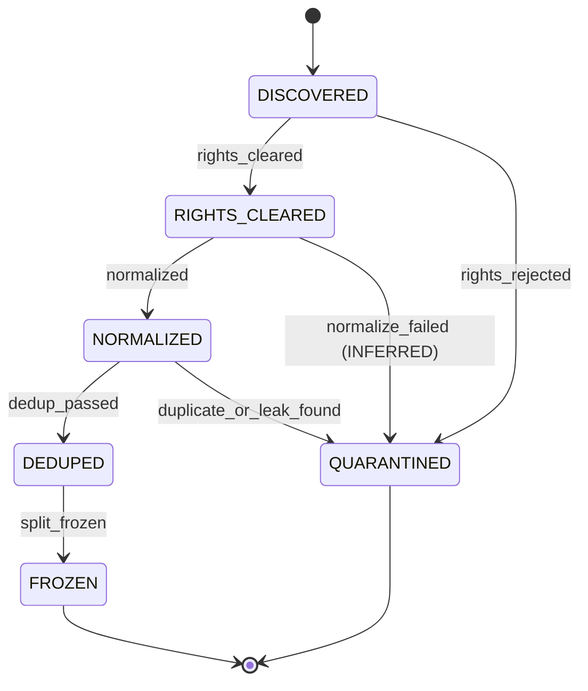
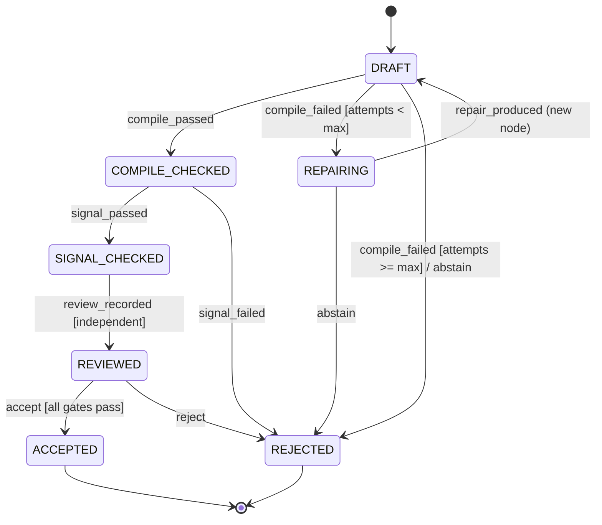
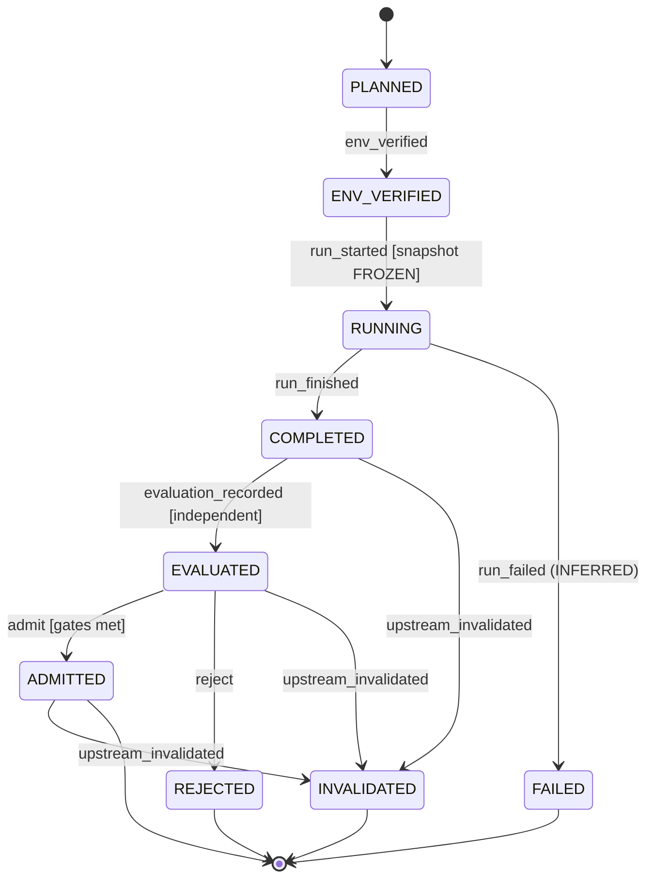
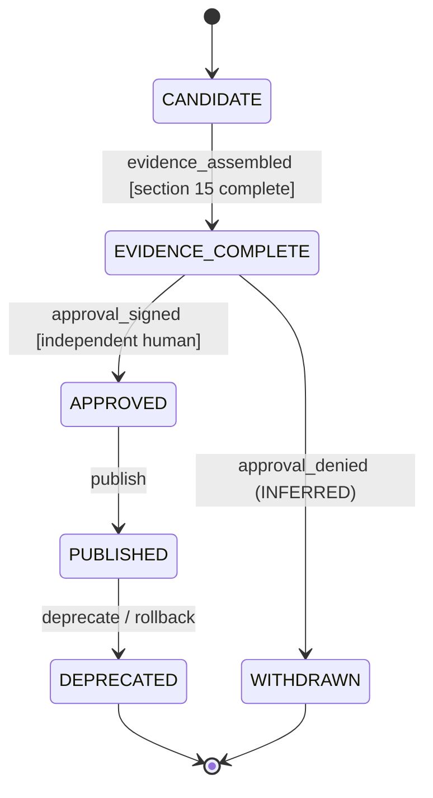

# FaustCoder: DAG-Compliant DSP Coding Model

- Status: DRAFT / refinement-ready
- Version: 0.1.0
- Target: NVIDIA DGX Spark (128 GB unified memory)

## 1. Constitution

FaustCoder is a locally deployable model specialized in generating, repairing, explaining and optimizing Faust DSP programs. Correctness is evidence-based, not inferred from model confidence. No candidate may be promoted without independent compiler and signal-behavior evaluation. Preserve dataset licensing, reproducibility and explicit human approval for release. Do not treat a successful compilation as proof of audio correctness.

## 2. Scope

In scope: Faust source generation, repair, DSP design, optimization, documentation, benchmark harness, dataset pipeline, model adapters, local serving and IDE-facing API.

Out of scope (v1): general-purpose coding, autonomous plugin publishing, unrestricted internet ingestion, production audio mastering and claims of formal DSP verification.

## 3. Domain model

Entities: SourceRecord, RightsRecord, Example, DatasetSnapshot, SplitManifest, TaskSpec, CandidateProgram, CompilerReceipt, DSPTestReceipt, BenchmarkSuite, BaseModel, Adapter, TrainingRun, EvaluationRun, DecisionRecord, ReleaseManifest.

All durable entities have schema_version, artifact_id, content_digest, created_at, producer, parents and immutable payload. Store lineage in a content-addressed artifact graph; model names and mutable aliases are not evidence.

## 4. Two DAGs

### 4.1 Evidence and execution DAG

source acquisition -> rights check -> normalization -> deduplication -> split freeze -> baseline -> training -> evaluation -> independent review -> release.

Each node references immutable parents. The graph must be acyclic; a new revision creates a new node, never rewrites ancestors. Invalidated ancestors invalidate dependent attestations until rerun. Execution orchestration may retry tasks, but retries create separate attempts and do not overwrite receipts.

### 4.2 DSP graph

Parse Faust programs into a typed signal-flow representation. Validate sequential, parallel, split, merge, and recursive composition against Faust's compiler semantics. Feedback is permitted only when semantically legal and appropriately delayed/stateful; never reject all recursive programs merely because their raw signal graph contains cycles. For DAG-based optimization and inspection, represent legal feedback as state-transition edges or collapsed strongly connected components with explicit delay boundaries. The graph view is a derived analysis artifact; the Faust compiler remains authoritative for language validity.

## 5. Requirements

- R-001: Reproducible DGX Spark environment, pinned dependencies and hardware diagnostics.
- R-002: Curated, license-traceable Faust corpus with source attribution and exclusion policy.
- R-003: Contamination-resistant splits by project, near-duplicate family and provenance.
- R-004: Frozen task suite including oscillators, filters, envelopes, routing, effects, modulation and stateful DSP.
- R-005: Compiler harness records exact Faust version, flags, exit code, diagnostics and source digest.
- R-006: Signal tests evaluate finite output, channel count, stability, spectral behavior, latency and CPU use where relevant.
- R-007: Baseline at least one 7B/14B dense candidate and one larger reference model; choose student based on measured quality and Spark throughput.
- R-008: LoRA-first training; QLoRA contingent on verified compatibility and throughput.
- R-009: Immutable dataset/model/evaluation lineage and reproducible release manifest.
- R-010: Local inference API supports generate, repair, explain and optimize with structured responses.
- R-011: Independent evaluation cannot be satisfied by self-reported model judgments.
- R-012: Explicit abstention and bounded repair attempts; no unbounded compiler-agent loop.
- R-013: Security: sandbox compiler execution, resource limits, no arbitrary shell execution from generated code, and artifact integrity checks.
- R-014: Training/evaluation data governance includes license eligibility, attribution, retention and removal procedure.

## 6. User journeys

- J-01: Producer describes a synthesizer -> model generates Faust -> compile -> signal tests -> deliver source and evidence.
- J-02: Developer submits failing Faust -> diagnostics -> bounded repair -> recompile -> show diff and receipts.
- J-03: DSP engineer requests optimization -> baseline measurement -> candidate -> semantic and signal comparison -> performance report; reject unproven equivalence.
- J-04: Maintainer ingests new examples -> rights and dedup checks -> new snapshot -> frozen split -> benchmark comparison -> release decision.

## 7. Workflows and states

OBSERVED (original text, unchanged):

- Dataset: DISCOVERED -> RIGHTS_CLEARED -> NORMALIZED -> DEDUPED -> FROZEN; rejected items go to QUARANTINED.
- Candidate: DRAFT -> COMPILE_CHECKED -> SIGNAL_CHECKED -> REVIEWED -> ACCEPTED or REJECTED.
- Training: PLANNED -> ENV_VERIFIED -> RUNNING -> COMPLETED -> EVALUATED -> ADMITTED or REJECTED.
- Release: CANDIDATE -> EVIDENCE_COMPLETE -> APPROVED -> PUBLISHED -> DEPRECATED.
- All transitions emit append-only receipts with actor, timestamp, input hashes and disposition.

The state machines below make those lifecycles explicit. Each is derived from
§3, §4.1, §5, §6, §9, §11, §15 and ADR-0001. States, events, guards or effects
that the original text does not state are labeled **INFERRED**. Implementers
treat each transition table as the contract.

### 7.0 Rules common to every machine

- Every transition appends one receipt `{actor, timestamp, input_hashes, from, event, to, disposition}`. Receipts are never edited. (OBSERVED: §7.)
- A state change never mutates an artifact payload. Any change to content creates a new artifact node with the old one as a parent and the machine restarts at its initial state for the new node. (OBSERVED: §4.1, ADR-0001.)
- `upstream_invalidated`: when an ancestor is invalidated, attestations of dependants are invalid until rerun. (OBSERVED: §4.1.) Modeled as the INFERRED state `INVALIDATED` where it applies.
- A retry is a new attempt with its own receipt; it never overwrites the previous one. (OBSERVED: §4.1.)

### 7.1 Dataset item lifecycle

Subject: a `SourceRecord` or `Example` on its way into a `DatasetSnapshot`.

- Initial state: `DISCOVERED`.
- Final states: `FROZEN` (included in a frozen snapshot and split), `QUARANTINED` (excluded).
- States: `DISCOVERED`, `RIGHTS_CLEARED`, `NORMALIZED`, `DEDUPED`, `FROZEN`, `QUARANTINED`.
- Events: `rights_cleared`, `rights_rejected`, `normalized`, `normalize_failed` (INFERRED), `dedup_passed`, `duplicate_or_leak_found`, `split_frozen`.

| From | Event | Guard | To | Effect |
|---|---|---|---|---|
| DISCOVERED | rights_cleared | RightsRecord shows license eligibility and attribution (R-002, R-014) | RIGHTS_CLEARED | Write RightsRecord; append receipt |
| DISCOVERED | rights_rejected | License ineligible, unknown or restricted (R-014) | QUARANTINED | Write exclusion receipt with reason; content not copied into any snapshot |
| RIGHTS_CLEARED | normalized | Deterministic transform succeeded | NORMALIZED | Write normalized Example as new node, parent = source; append receipt |
| RIGHTS_CLEARED | normalize_failed | Transform error (INFERRED) | QUARANTINED | Append receipt with diagnostics (INFERRED) |
| NORMALIZED | dedup_passed | No exact or near-duplicate family conflict; not in holdout family (R-003) | DEDUPED | Record duplicate-family id; append receipt |
| NORMALIZED | duplicate_or_leak_found | Duplicate or holdout-contamination match (R-003) | QUARANTINED | Append exclusion receipt naming the conflicting family |
| DEDUPED | split_frozen | SplitManifest assigns the item by project, near-duplicate family and provenance (R-003) | FROZEN | Write DatasetSnapshot and signed SplitManifest digests (KANBAN T07); append receipt |

Illegal transitions:

- `DISCOVERED` -> `NORMALIZED`, `DEDUPED` or `FROZEN`: the rights check is never skipped (R-002, R-014).
- Any transition out of `FROZEN`: a frozen snapshot is immutable. A removal request (R-014) produces a new snapshot without the item, with the old snapshot as parent. (INFERRED.)
- `QUARANTINED` -> any state: re-admission needs a new `DISCOVERED` node with a new RightsRecord. (INFERRED.)
- A holdout item moving into a training or development split (§9).

### 7.2 Candidate program lifecycle

Subject: a `CandidateProgram` produced for a `TaskSpec` (J-01), a repair request (J-02) or an optimization request (J-03).

- Initial state: `DRAFT`.
- Final states: `ACCEPTED`, `REJECTED`.
- States: `DRAFT`, `COMPILE_CHECKED`, `SIGNAL_CHECKED`, `REVIEWED`, `ACCEPTED`, `REJECTED`, `REPAIRING` (INFERRED from J-02 and R-012).
- Events: `compile_passed`, `compile_failed`, `repair_produced` (INFERRED), `abstain` (R-012), `signal_passed`, `signal_failed`, `review_recorded`, `accept`, `reject`.
- Context: `repair_attempts` (count), `max_repair_attempts` (declared bound, value open: INFERRED, see D-005).

| From | Event | Guard | To | Effect |
|---|---|---|---|---|
| DRAFT | compile_passed | Sandboxed pinned compiler exit code 0 (R-005, R-013) | COMPILE_CHECKED | Write CompilerReceipt |
| DRAFT | compile_failed | `repair_attempts < max_repair_attempts` | REPAIRING | Write CompilerReceipt with diagnostics; increment `repair_attempts` |
| DRAFT | compile_failed | `repair_attempts >= max_repair_attempts` | REJECTED | Write CompilerReceipt; record abstention disposition (R-012) |
| DRAFT | abstain | Model or policy declines (R-012) | REJECTED | Record abstention disposition |
| REPAIRING | repair_produced | Repair output is a new CandidateProgram whose parent is the failed one (INFERRED) | DRAFT | New node; diff recorded for J-02 (INFERRED) |
| REPAIRING | abstain | Repair declined or produced no change (INFERRED) | REJECTED | Record abstention disposition |
| COMPILE_CHECKED | signal_passed | All signal tests in the TaskSpec `test_profile` pass: finite output, channel count, stability, spectral behavior, latency, CPU where relevant (R-006) | SIGNAL_CHECKED | Write DSPTestReceipt |
| COMPILE_CHECKED | signal_failed | Any required signal test fails | REJECTED | Write DSPTestReceipt with failing metrics |
| SIGNAL_CHECKED | review_recorded | Reviewer is independent of the generating model (R-011) | REVIEWED | Record review against gate results |
| REVIEWED | accept | All gates pass; for J-03, semantic and signal comparison against the baseline shows no regression and equivalence is evidenced | ACCEPTED | Write DecisionRecord (disposition = accepted) |
| REVIEWED | reject | Any gate fails, or J-03 equivalence is unproven | REJECTED | Write DecisionRecord (disposition = rejected, rationale) |

Illegal transitions:

- `DRAFT` -> `SIGNAL_CHECKED`, `REVIEWED` or `ACCEPTED`: signal tests and review need a successful compile.
- `COMPILE_CHECKED` -> `ACCEPTED`: compilation alone is never acceptance (§1, §9, ADR-0001).
- `SIGNAL_CHECKED` -> `ACCEPTED` without `REVIEWED`.
- `review_recorded` or `accept` driven by the generating model's self-assessment (R-011).
- `compile_failed` -> `REPAIRING` when the bound is reached; no unbounded loop (R-012).
- Any transition out of `ACCEPTED` or `REJECTED`; a new attempt is a new node.
- Rejecting a program only because its raw signal graph contains legal, delayed feedback (§4.2, ADR-0001).

### 7.3 Training run lifecycle

Subject: a `TrainingRun` producing an `Adapter` (R-008).

- Initial state: `PLANNED`.
- Final states: `ADMITTED`, `REJECTED`, `FAILED` (INFERRED), `INVALIDATED` (INFERRED).
- States: `PLANNED`, `ENV_VERIFIED`, `RUNNING`, `COMPLETED`, `EVALUATED`, `ADMITTED`, `REJECTED`, `FAILED` (INFERRED), `INVALIDATED` (INFERRED).
- Events: `env_verified`, `run_started`, `run_finished`, `run_failed` (INFERRED), `evaluation_recorded`, `admit`, `reject`, `upstream_invalidated` (INFERRED from §4.1).

| From | Event | Guard | To | Effect |
|---|---|---|---|---|
| PLANNED | env_verified | Pinned dependencies and hardware diagnostics recorded on DGX Spark (R-001) | ENV_VERIFIED | Record environment digest |
| ENV_VERIFIED | run_started | Dataset snapshot is `FROZEN`; split, config and code revision digests pinned (R-009) | RUNNING | Write TrainingRun with parents |
| RUNNING | run_finished | Training exited cleanly | COMPLETED | Record `checkpoint_digests` |
| RUNNING | run_failed | Crash, OOM or timeout (INFERRED) | FAILED | Append failure receipt; a retry is a new TrainingRun (§4.1) |
| COMPLETED | evaluation_recorded | Independent EvaluationRun on the development suite and sealed holdout (§9, R-011) | EVALUATED | Write EvaluationRun with paired comparison and confidence intervals |
| EVALUATED | admit | Gates met against the frozen baseline (D-005) | ADMITTED | Write DecisionRecord (admitted) |
| EVALUATED | reject | Gates not met | REJECTED | Write DecisionRecord (rejected) |
| COMPLETED, EVALUATED, ADMITTED | upstream_invalidated | An ancestor (dataset, split, base model, code) was invalidated | INVALIDATED | Mark dependent attestations invalid until rerun (INFERRED) |

Illegal transitions:

- `PLANNED` -> `RUNNING`: the environment is verified first (R-001).
- `run_started` on a dataset that is not `FROZEN`, or with any holdout item in the training data (§9).
- `COMPLETED` -> `ADMITTED`: admission needs an independent evaluation.
- Overwriting a failed run's receipts on retry (§4.1).
- Any transition out of `REJECTED`, `FAILED` or `INVALIDATED`.

### 7.4 Release lifecycle

Subject: a `ReleaseManifest`.

- Initial state: `CANDIDATE`.
- Final states: `DEPRECATED`, `WITHDRAWN` (INFERRED).
- States: `CANDIDATE`, `EVIDENCE_COMPLETE`, `APPROVED`, `PUBLISHED`, `DEPRECATED`, `WITHDRAWN` (INFERRED).
- Events: `evidence_assembled`, `approval_signed`, `approval_denied` (INFERRED), `publish`, `deprecate`, `rollback` (INFERRED from §15 rollback artifact).

| From | Event | Guard | To | Effect |
|---|---|---|---|---|
| CANDIDATE | evidence_assembled | Every §15 item present: immutable parent graph, rights-cleared dataset, frozen evaluation receipts, compiler and signal results, regression comparison, security review, model card, rollback artifact | EVIDENCE_COMPLETE | Write ReleaseManifest draft with all digests |
| EVIDENCE_COMPLETE | approval_signed | Independent human approver signs (§15, V1.0) | APPROVED | Record signed approval |
| EVIDENCE_COMPLETE | approval_denied | Approver declines (INFERRED) | WITHDRAWN | Record rationale |
| APPROVED | publish | Manifest signed; model card and data provenance statement attached (§11) | PUBLISHED | Publish signed release manifest |
| PUBLISHED | deprecate | Superseded or retired | DEPRECATED | Record deprecation notice |
| PUBLISHED | rollback | Post-release defect; rollback artifact verified (INFERRED) | DEPRECATED | Restore previous release from rollback artifact; record receipt |

Illegal transitions:

- `CANDIDATE` -> `APPROVED` or `PUBLISHED`: evidence first (§15).
- `EVIDENCE_COMPLETE` -> `PUBLISHED`: human approval is mandatory; autonomous publishing is out of scope (§2).
- `DEPRECATED` or `WITHDRAWN` -> any state; a re-release is a new ReleaseManifest.

## 8. Contracts

### TaskSpec

`{task_id, task_type, prompt, constraints, expected_io, test_profile, schema_version}`

### CompilerReceipt

`{source_sha256, faust_version, command, exit_code, stdout_digest, stderr_digest, duration_ms, environment_digest}`

### DSPTestReceipt

`{source_sha256, test_suite_digest, sample_rate, block_size, seed, metrics, thresholds, passed, harness_digest}`

### TrainingRun

`{run_id, base_model_revision, dataset_digest, split_digest, config_digest, code_revision, hardware_profile, checkpoint_digests, metrics}`

### DecisionRecord

`{candidate_digest, baseline_digest, suite_digest, gate_results, reviewer, disposition, rationale, timestamp}`

Schemas must be implemented in JSON Schema or Pydantic with validation tests before production use.

## 9. Evaluation

Metrics: compile@1, compile@k, task pass@1, DSP correctness pass rate, repair success, semantic regression rate, median/p95 generation latency, tokens/sec, peak memory, and test CPU cost.

Test classes: syntax, arity, routing, recursion/delay, deterministic numerical response, frequency response, envelope shape, NaN/Inf, clipping, silence, boundary inputs, and performance.

Frozen holdout is never used for training, prompt tuning or candidate selection. Use a separate development suite. Report confidence intervals for aggregate rates and paired comparisons against the baseline.

Provisional V0.2 aspiration: >=90% compile@1 on held-out tasks, subject to baseline measurement and task-mix calibration. No release based on compilation alone.

## 10. Architecture

`corpus/` provenance + rights; `datasets/` transforms and split manifests; `faust/` compiler harness and graph analysis; `eval/` signal tests and benchmarks; `train/` Spark configs and launchers; `serve/` inference API; `schemas/` contracts; `receipts/` immutable evidence; `docs/` architecture, runbooks, decisions; `specs/` versioned specifications.

Recommended stack: Python, PyTorch, Transformers, PEFT/TRL, Faust CLI, pytest, Parquet, MLflow (tracking only, immutable manifest authoritative), OCI containers, local model server. Verify ARM64/Blackwell compatibility on DGX Spark before pinning any training stack.

## 11. Security, privacy and governance

Execute compiler/test workers in restricted containers with no network, bounded CPU/RAM/time, read-only inputs and isolated output directories. Treat retrieved examples, prompts and generated code as untrusted. Prevent dataset poisoning, benchmark leakage and unauthorized copyrighted redistribution. Publish a model card and data provenance statement with every release.

## 12. Versioned roadmap and acceptance

- V0.1 FOUNDATION: environment lock, compiler harness, schemas, corpus policy, frozen baseline suite. PASS when another operator can reproduce compiler receipts and baseline metrics from a clean checkout.
- V0.2 SPECIALIST: rights-cleared corpus, split freeze, 7B/14B benchmark, LoRA experiment. PASS when improvement is statistically supported on development tasks and holdout remains sealed.
- V0.3 DSP VERIFIER: signal tests, feedback graph semantics, bounded repair, optimization comparisons. PASS when known-bad DSP programs fail gates and legal delayed feedback passes.
- V0.4 PRODUCT: local serving, API, IDE integration, telemetry and failure handling. PASS when end-to-end user journeys run on Spark with reproducible receipts.
- V1.0 RELEASE: independent review, security assessment, model/data cards, immutable manifest, rollback procedure. PASS only with signed approval and complete evidence.

## 13. Dependency-ordered implementation tasks

T01 constitution + ADRs -> T02 schemas + artifact store -> T03 compiler sandbox -> T04 DSP test harness -> T05 corpus rights inventory -> T06 normalization/dedup -> T07 split freeze -> T08 baseline models -> T09 Spark throughput/memory study -> T10 training configs -> T11 evaluation and paired comparisons -> T12 decision gate -> T13 local serving -> T14 IDE integration -> T15 independent security/quality review -> T16 release.

Parallelism permitted only where declared dependencies allow it. Every task requires owner, inputs, outputs, acceptance test, failure disposition and evidence path.

## 14. Open decisions

- D-001: Confirm Faust DSP language (assumed).
- D-002: Select student model after baseline: Qwen3-14B vs 7B or 30B MoE alternative.
- D-003: Choose initial sample rates and DSP target runtimes.
- D-004: Determine corpus redistribution versus training-only rights.
- D-005: Set quality gates using observed baseline and task severity.
- D-006: Decide local-only versus optional hosted teacher usage and data boundaries.

## 15. Non-negotiable release gate

No model release without: immutable parent graph, rights-cleared dataset, frozen evaluation receipts, compiler and signal test results, regression comparison, security review, model card, rollback artifact and independent approval.

## 16. Governing workflows

INFERRED: added for Spec Kit compliance. The skills and CI files below govern
this spec; plan, tasks and agent briefs copy this list rather than inventing
another.

| Workflow | Applies to | Owner |
|---|---|---|
| anti-slop-code | All product code (harness, pipeline, eval, serve) | Cloud agent implements |
| production-systems | Sandboxed workers, artifact store, serving, release | Cloud agent implements; FORGE decomposes |
| google-developer-style | All docs, specs, ADRs, model and data cards | SCRIBE |
| spec-kit | Constitution, spec, plan, tasks, state machines | FORGE |
| Threat model (R-013, §11) | Sandbox, dataset poisoning, benchmark leakage | ADVERSARY |

CI workflows (`.github/workflows/`): `spec-check.yml` (required docs and Spec
Kit structure) is the existing path. Repository hygiene adds lint, link-check,
secret-scan and actionlint workflows; implementation tasks reuse those rather
than adding new CI paths.
