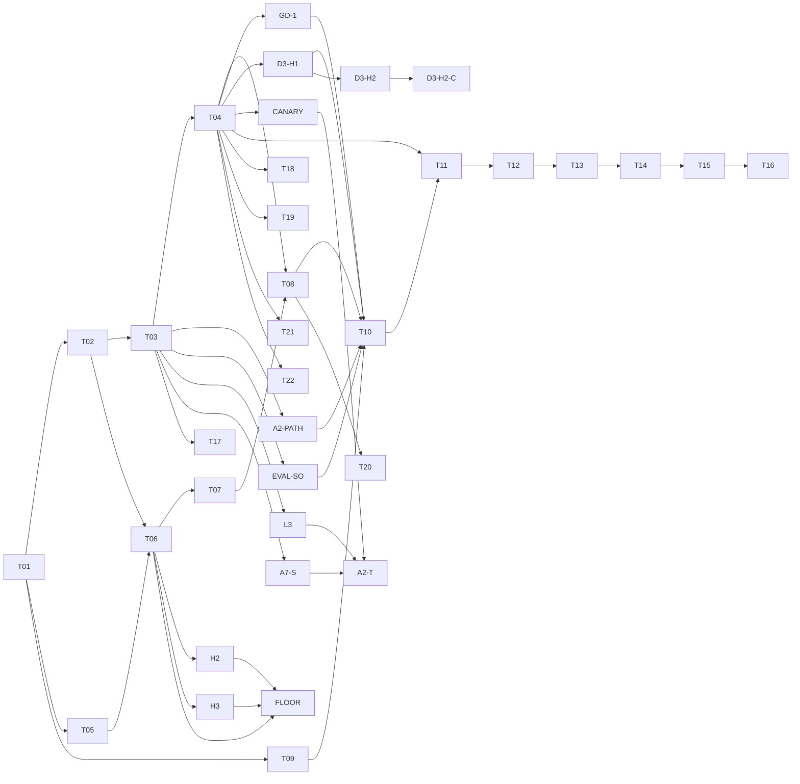

# Tasks: BlackDog (spec 001)

- Input: [spec.md](spec.md), [plan.md](plan.md), [data-model.md](data-model.md), [contracts/](contracts/)
- Mirror: [KANBAN.md](../../KANBAN.md) and the GitHub Project "FaustCoder". Task IDs match KANBAN.

Format: `- [ ] Txx [P?] [Story] Description`. `[P]` means it can run in parallel
with other `[P]` tasks once its dependencies are met. Every task lists
dependencies, acceptance evidence (OBSERVED from KANBAN), governing workflows
(copied from spec §16) and an evidence path (INFERRED). Every task also needs an
owner, inputs, outputs, failure disposition and evidence path before it starts
(spec §13).

Governing workflows for all implementation tasks: anti-slop-code,
production-systems, google-developer-style. State-machine tasks also follow
spec-kit; security-relevant tasks add ADVERSARY review.

## Phase 1: Setup

- [ ] T01 [Setup] Constitution and ADRs.
  - Depends on: none. Milestone: v0.1.
  - Acceptance: reviewed architectural decisions; ADR-0001 moves from PROPOSED to ACCEPTED.
  - Workflows: spec-kit, google-developer-style. Owner: FORGE, SCRIBE.
  - Evidence: `docs/adr/`, `.specify/memory/constitution.md`.

## Phase 2: Foundational (blocks every user story)

- [x] T02 [Found] JSON schemas and immutable artifact store.
  - Done in #34 and #35 (2026-10-17).
  - Depends on: T01. Milestone: v0.1.
  - Acceptance: schema validation and digest tests; store rejects payload mutation and parent cycles (constitution II).
  - Implements: [contracts/](contracts/), [data-model.md](data-model.md).
  - Workflows: anti-slop-code, production-systems. Evidence: `receipts/T02/` (INFERRED).
- [x] T03 [Found] Sandboxed Faust compiler harness.
  - Done in #38, with #40, #42 and #46 (2026-10-17).
  - Depends on: T02. Milestone: v0.1.
  - Acceptance: reproducible compiler receipts (R-005); no network, bounded resources (R-013).
  - Amended 0.3.0 (ADR-0004): wrap libfaust from faustwasm 0.19.0 in a Node.js worker; cross-check with the native Faust 2.88.0 CLI; classify diagnostics.
  - Amended 0.3.4 (ADR-0006): the R-005 reward ladder is A1–A7 in the ADR. ADR-0006 is in force in reward code (`grade_receipt`, spec §23).
  - Workflows: production-systems, ADVERSARY review. Evidence: `receipts/T03/` (INFERRED).
- [x] T04 [Found] DSP signal test harness.
  - Done in #41, with the N6 follow-up #45 (2026-10-17). Open: the ARM goldens compare on the DGX Spark.
  - Depends on: T03. Milestone: v0.1.
  - Acceptance: known-good and known-bad fixtures; legal delayed feedback passes (ADR-0001, V0.3).
  - Amended 0.3.0 (ADR-0004): offline render with faustwasm at 44.1 and 48 kHz; reference comparison in the style of Faust `tests/impulse-tests`; CPU only on promotion candidates.
  - Follow-up (N6, Danny yes 2026-10-17): `nonlinear-suite-v1` renders eight float32 stimuli at the 144000-frame floor. The signed sample check is the gate. THD+N, IMD and the Farina inverse filter are diagnostics. The suite is not in `REWARD_PROFILES`. TaskSpec `effect` is a closed enum; only `linear` and `time_invariant` are rewardable. `require_task_rewardable` is called by `dataset_reward_row` and `_rl_batch` (D5). `nonlinear-suite-fallback-v1` is the four-stimulus fallback. x86 DSP-bank goldens live in `tests/fixtures/signal/`. `scripts/signal_cross_arch.py` compares them; the ARM side is pending on the DGX Spark.
  - Workflows: anti-slop-code, production-systems. Evidence: `faustcoder/signal.py`, `docs/runbooks/signal-harness.md`; local receipts under the artifact store (gitignored).

## Phase 3: User story J-04, maintainer ingests examples through to a release decision

Implements the dataset machine (spec §7.1) and training machine (spec §7.3).

- [x] T05 [P] [J-04] Source rights inventory.
  - Done in #37 (2026-10-17).
  - Depends on: T01. Milestone: v0.1.
  - Acceptance: provenance and exclusion receipts; implements `rights_cleared` and `rights_rejected` transitions.
  - Workflows: production-systems, ADVERSARY review (poisoning, licensing). Evidence: `corpus/` records, receipts.
- [x] T06 [J-04] Normalization and dedup.
  - Done in #39 (2026-10-17). Open follow-ups: H2, H3 and FLOOR. `TOKEN_FLOOR=40` stays provisional.
  - Depends on: T05, T02. Milestone: v0.2.
  - Acceptance: deterministic snapshot; implements `normalized` and `dedup_passed` transitions.
  - Proposed (D-013, Danny yes 2026-10-17 1:04 PM PT): an n-gram or AST near-duplicate filter on generated `.dsp` against the training-only set, including vendored near-copies of `faust/examples`. The threshold is not set. This is a requirement to carry into the task, not an implementation in T05.
  - Amended 0.3.5 (Q3): dedup uses provisional `TOKEN_FLOOR=40`. P0 exits only if that floor is accepted by the Q3 protocol or marked provisional with a recorded leakage caveat. The protocol runs after H2 and H3.
  - Workflows: anti-slop-code, production-systems.
- [ ] T07 [J-04] Split freeze.
  - Depends on: T06. Milestone: v0.2.
  - Acceptance: leakage checks and signed split manifest; implements `split_frozen` (R-003).
  - Proposed (D-013): the same near-duplicate filter is a split gate, so training-only and impulse-test families cannot land in eval or the sealed holdout. The threshold is not set.
  - Amended 0.3.5 (Q3, Q4): a freeze on the provisional floor records a leakage caveat and a scheduled re-check. Leaked items are removed and the removal is logged. Holdout novelty is re-checked once the floor is accepted, before any P3 exit claim rests on the holdout.
  - Workflows: production-systems.
- [ ] T08 [J-04] Baseline models.
  - Depends on: T04, T07. Milestone: v0.2.
  - Acceptance: frozen baseline measurements (R-007); input to D-002 and D-005.
  - Workflows: production-systems.
- [x] T09 [P] [J-04] DGX Spark feasibility study (spark-af42 fingerprint complete; second machine conditional).
  - Status: the study and `env_verified` harness landed in #36. On 2026-10-20, spark-af42 on `0cd3382` produced exit 0 / `env_verified`; both artifact envelopes verified and all 17 off-host file checksums passed. See [receipt IDs and locations](../../docs/runbooks/spark-local-setup.md#t09-fingerprint-evidence). The repaired candidate subsequently passed on `1ae20ba` at 2026-10-21 00:29:27 UTC (2026-10-20 PT): exit 0 / `env_verified`, both envelopes verified, 20 off-host checksums passed. See [candidate receipts](../../docs/runbooks/spark-local-setup.md#repaired-candidate-t09-fingerprint). Together with the cited external benchmarks, this is the per-machine v0.2 R-001 evidence; both receipts have `stack_pin_allowed=false`. A second Spark needs its own fingerprint if it will train; repeat after environment changes. T01 remains a dependency, and this completion does not authorize training.
  - Depends on: T01. Milestone: v0.2.
  - Acceptance: for v0.2, cited external DGX Spark benchmarks plus a per-machine environment fingerprint receipt (R-001, amended 0.3.1); implements `env_verified`. On-hardware throughput is deferred to T10 on the dedicated, cleared Spark.
  - Workflows: production-systems.
- [ ] T10 [J-04] Training path P1 to P3 (ADR-0002).
  - Environment status (2026-10-20): separate `~/blackdog-t10-candidate` on spark-af42 is DEPENDENCY/CUDA VALIDATED; TRAINING GATES PENDING. The audited cuSPARSELt 0.8.1 repair changes only WHEEL/RECORD, uses `manylinux_2_27_aarch64`, and preserves vendor payload bytes and torch's exact pin. Normal dependency resolution, pip check, installed integrity, repeated dense CUDA checks and 12/12 sparse comparisons passed. See [repair and receipt locations](../../docs/runbooks/spark-local-setup.md#validated-cusparselt-repair-candidate). The original `~/blackdog-t10-venv` remains unchanged and blocked; r9venv/DSP setup and T09 receipts are preserved (52,333 baseline files/symlinks unchanged; 28 off-host evidence checksums verified). The old receipt's `stack_pin_allowed=false` describes r9venv, not this candidate. The fresh candidate fingerprint on `1ae20ba` is COMPLETE: exit 0 / `env_verified`, 20 backup checksums verified and 89,975 baseline files/symlinks unchanged. Run from `~/BlackDog` with the candidate interpreter to select merged source over its preserved editable copy. See [candidate receipt IDs and locations](../../docs/runbooks/spark-local-setup.md#repaired-candidate-t09-fingerprint); `stack_pin_allowed=false`, inference/LoRA skipped (`no_local_model`). That fingerprint predates the approved Qwen download and smoke below. Recheck workload clearance; complete formal dataset/split/baseline qualification and repeated representative throughput/memory measurements before stack-pin review. Project training gates remain outstanding; no production training run is claimed.
  - Synthetic infrastructure diagnostic (2026-10-20 PT, checkout `e53bf46`): PASS using random tiny GPT-2 initialization and generated token IDs in the repaired candidate. Five LoRA steps plus a resumed step had finite losses/gradients and adapter changes, with frozen base unchanged. Reloaded logits, optimizer state and resumed continuation matched exactly; peak GPU allocation ~65.5 MiB. Attempt 1 failed only in result serialization; corrected attempt 2 exited 0 with assertions intact. All 90,014 baseline files/symlinks unchanged and 47 backup checksums verified. See [results and both receipt locations](../../docs/runbooks/spark-local-setup.md#offline-training-and-checkpoint-diagnostic). This earlier synthetic diagnostic is not representative model training, G10 acceptance or a stack pin; subsequent actual-model smoke evidence is recorded below.
  - Qwen smoke (2026-10-20 PT): PASS on the repaired candidate, pinned Qwen2.5-Coder-1.5B revision `df3ce67c0e24480f20468b6ef2894622d69eb73b`. Of 49 provenance-verified MIT examples, 35 passed compiler/signal sanity; 14 failed and were excluded. Family-separated 28 train / 7 diagnostic examples supported 20 LoRA steps and exact fresh-process reload/resume; frozen base unchanged, peak allocation ~5.93 GiB. No sealed holdout existed; this single-project diagnostic is not a formal T07 split, semantic/reward evaluation, G10 or stack pin. The library-import blocker was fixed in merged #86 (`e3c9542`), with 126 focused regressions and 642 full CI tests passing. Merged-main verification passed 46 signal tests. See [configuration, limitations, receipts and remaining gates](../../docs/runbooks/spark-local-setup.md#qwen-t10-smoke-and-merged-library-rendering). All 156 smoke-backup and 16 merged-main-backup checksums passed; environments, weights, checkpoints and receipts remain preserved outside Git. `stack_pin_allowed=false`.
  - Depends on: T08, T09, GD-1, A2-PATH, EVAL-SO, D3-H1. Milestone: v0.2 (P1, P2) and v0.3 (P3).
  - Acceptance: one pinned, reproducible `TrainingRun` per phase with its exit-gate result (R-008, R-009, R-015); P1 may be a recorded skip; implements `run_started` to `COMPLETED`.
  - Sub-steps: P1 continued pretraining or skip; P2 SFT on validated pairs; P3 compiler-feedback RL (R-016).
  - Amended 0.3.5 (Q4): ADR-0002 is accepted in full (Jev's default; Danny may still choose P3 PROPOSED). P3 reward is the ADR-0006 grader with the Q1 binary ruling, whole-group drop, and A2-T as the only auto-attribution path. The P3 exit gate requires the graded/ungraded split, the A7 quarantine rate and the group-drop rate within pre-registered limits, and no frozen auto-attribution signature at exit. Only the ~5M-token CPT-skip threshold is ratified. The 2-point loss and compile@10 noise are paired-CI tests. GD-1 is a prerequisite, not a follow-on.
  - Amended 0.3.7 (D3 option H): D3-H1 blocks T10. P3 also waits on D3-H2. The P3 exit gate adds audit disagreements = 0 unresolved and the consumed log intact. D3-H2 does not block P1 or P2. Every T10 training row from `rl_batch_from_records` carries an explicit non-empty `example_id` (the signed record id). A training row without one is refused.
  - Amended 0.3.10 (D3-H2-C, issue #64): P3 also waits on D3-H2-C. A halt clears only with a valid human triage signature under spec §26 0.3.10. A run-key MAC alone does not clear it. P3 refuses to start unless the grader runs as the dedicated `fc-grader` OS account, distinct from any reviewer and from the box user (uid 1000).
  - Workflows: anti-slop-code, production-systems.
- [ ] T11 [J-04] Independent DSP evaluation.
  - Depends on: T10, T04. Milestone: v0.3.
  - Acceptance: paired metrics and regression results with confidence intervals (§9, R-011).
  - Workflows: production-systems.
- [ ] T12 [J-04] Promotion decision.
  - Depends on: T11. Milestone: v0.3.
  - Acceptance: human review and DecisionRecord; implements `admit` and `reject`.
  - Workflows: spec-kit, google-developer-style.

## Phase 3b: Target lanes (ADD 0.3.0, ADR-0004)

Each lane emits a `TargetReceipt` and has known-good and known-bad fixtures.
Lanes run in parallel with T10.

- [ ] T17 [P] [Lane] Language-backend lane (R-024).
  - Depends on: T03. Milestone: v0.3.
  - Acceptance: `-lang cpp`, `c`, `rust` and `cmajor` output compiles in pinned toolchains, and compiled runs match the host render.
  - Workflows: anti-slop-code, production-systems.
- [ ] T18 [P] [Lane] Plugin lane (R-023, D-012).
  - Depends on: T04. Milestone: v0.3.
  - Acceptance: CLAP (`faust2clap`), VST3 (clap-wrapper) and LV2 (`faust2lv2`) build in a Linux container; `clap-validator`, `pluginval` and `lv2lint` pass on known-good fixtures and fail on known-bad ones; parameter-map check passes. AU deferred to macOS CI.
  - Workflows: anti-slop-code, production-systems, ADVERSARY review (container and SDK supply chain).
- [ ] T19 [P] [Lane] Embedded lane (R-019, D-008).
  - Depends on: T04. Milestone: v0.3.
  - Acceptance: `faust2daisy` and `faust2teensy` builds with pinned SDKs; flash and RAM budgets from linker maps; CPU proxy budget; real-time checks (R-021). No board purchase.
  - Workflows: anti-slop-code, production-systems.
- [ ] T20 [Lane] Remix tasks and novelty metric (R-020, D-010).
  - Depends on: T08. Milestone: v0.3.
  - Acceptance: remix tasks in the dev suite with two or more source demos; novelty reported as a dev metric; correctness uses the normal gates.
  - Workflows: anti-slop-code.
- [ ] T21 [P] [Lane] Real-time safety checks (R-021).
  - Depends on: T04. Milestone: v0.3.
  - Acceptance: fixtures with NaN, denormals, unbounded delay memory and allocation in the callback are rejected on every lane.
  - Workflows: anti-slop-code, production-systems.
- [ ] T22 [P] [Lane] FPGA F0 spike (R-022, D-009).
  - Depends on: T04. Milestone: v0.5-fpga. Timebox: 1 week.
  - Acceptance: DecisionRecord comparing three lowerings for a one-pole low-pass and a sine oscillator: Verilator sim vs Faust render, Yosys and nextpnr results for iCE40 and ECP5, audio-rate throughput.
  - Workflows: production-systems, spec-kit (DecisionRecord).

## Phase 4: User stories J-01, J-02, J-03 (generate, repair, optimize)

Implements the candidate machine (spec §7.2).

- [ ] T13 [J-01, J-02, J-03] Local serving API.
  - Depends on: T12. Milestone: v0.4.
  - Acceptance: contract tests against [contracts/inference-api.md](contracts/inference-api.md); bounded repair (R-012).
  - Workflows: anti-slop-code, production-systems, ADVERSARY review.
- [ ] T14 [J-01, J-02, J-03] IDE integration.
  - Depends on: T13. Milestone: v0.4.
  - Acceptance: end-to-end journey tests for J-01 to J-03 on Spark with reproducible receipts.
  - Workflows: anti-slop-code, production-systems.

## Phase 5: Polish and release

Implements the release machine (spec §7.4).

- [ ] T15 Security and quality review.
  - Depends on: T14. Milestone: v1.0.
  - Acceptance: independent audit.
  - Workflows: ADVERSARY, production-systems.
- [ ] T16 Release.
  - Depends on: T15. Milestone: v1.0.
  - Acceptance: signed release manifest and rollback test; full §15 gate.
  - Workflows: production-systems, google-developer-style (model and data cards).

## Follow-ups 0.3.5 (Jev, 2026-10-17 7:40 PM PT)

Mirror of the KANBAN rows. The rulings are the verbatim blocks in spec §24.
These tasks are the implementation. This record does not change code.

- [x] L1 [Found] RangeError is stack overflow only for `Maximum call stack size exceeded`.
  - Depends on: T03. Milestone: v0.3. Done in #49 (`f0fcdf9`), on main with #46 (`42ee1e4`).
  - Acceptance: landed. Prerequisite for A2-T leaving shadow.
  - Workflows: anti-slop-code, production-systems.
- [x] L2 [Found] Line-start matching on the failing stage; split on `\n` only.
  - Depends on: T03. Milestone: v0.3. Done in #49. This is the r5 L2 fix Jev cited.
  - Acceptance: landed. `_compile_stack_line` splits on `\n` only.
  - Workflows: anti-slop-code, production-systems.
- [ ] L3 [Found] Rerun hooks for exits 124 and 125 on the compile and render stages (r5 L3).
  - Depends on: T03. Milestone: v0.3.
  - Acceptance: the hooks feed A2-T in shadow only. Not quarantine-age tracking, and not a substitute for it.
  - Workflows: production-systems.
- [ ] A7-S [J-04] Per-signature attribution-rate tracking.
  - Depends on: T03. Milestone: v0.3. Prerequisite of A2-T.
  - Acceptance: provisional thresholds 20% share, 2× rise, 500-sample window, distinct from A7. `resolved_by: "auto"` and stored evidence. A gold-canary crash freezes its signature. Reviewed against shadow data before A2-T goes live.
  - Workflows: production-systems.
- [ ] CANARY [J-04] Scheduled gold canary: dev-suite references, cleared-corpus sample, SFT targets, run on a schedule.
  - Depends on: T04. Milestone: v0.3. Prerequisite of A2-T.
  - Acceptance: the canary runs on a schedule and its result is recorded. A2-T goes live only while it is clean. Any crash there freezes its signature through A7-S.
  - Workflows: production-systems.
- [ ] A2-T [J-04] A2-T shadow mode, then live auto-attribution.
  - Depends on: L1, L2, L3, A7-S, CANARY. Milestone: v0.3.
  - Acceptance: shadow computes and logs attributions; humans triage. Shadow mode runs on a separate path that never grades: it may rerun and log attributions, but its output never reaches `reward_value` or a receipt. That path is not a training caller, so needing reruns in shadow does not conflict with A2-PATH. Leaves shadow only when L1–L3 have landed, agreement is on a sample fixed before shadow starts, the gold canary (dev-suite references, cleared-corpus sample, SFT targets) is clean and any crash there freezes its signature, A7-S thresholds are reviewed, and the go-live is recorded. Crash rows below ~0.1% of samples keep auto-attribution off entirely. That rate is a reason to stay off, never a reason to go live.
  - Workflows: production-systems, ADVERSARY review.
- [x] D3-H1 [J-04] MAC'd reward-row records (D3 option H).
  - Depends on: T04. Milestone: v0.3. Prerequisite of T10.
  - Acceptance: a persisted row carries an HMAC tag under a per-run key derived from a mode `0400` root key owned by `fc-grader`. Every load re-checks the MAC, the pins, the source, the full task, the reference and the profile, then `grade_receipt` with no `rerun`, `known_good` or `triage`. `passed` is true only when `metrics.failures` is empty. A group with a missing, duplicate, ungraded or quarantined member is dropped and claimed so it does not re-enter. A stale pin is not regraded into training. A1 stays `0.0`. Unattributed 124/125/126, crashes, internal errors and a `ShadowLog` stay ungraded. Done in the D3-H1 change.
  - Workflows: production-systems, ADVERSARY review.
- [ ] D3-H1-N9 [J-04] Re-check the stored native envelope on load.
  - Depends on: D3-H1. Milestone: v0.3. Does not block T10. Follow-up from the D3-H1 adversary review (N9).
  - Acceptance: `regrade_record` passes the stored native envelope into `grade_receipt`. A row whose rollout grade used a native stack match is re-checked, instead of always dropping as `outcome`.
  - Workflows: production-systems.
- [ ] D3-H1-N10 [J-04] Consumed-log integrity and incremental re-read.
  - Depends on: D3-H1. Milestone: v0.3. Does not block T10. Follow-up from the D3-H1 adversary review (N10).
  - Acceptance: the consumed log and the rows log each have an integrity check. A torn last line of either log does not fail every later load, and a torn rows-log tail followed by a later append does not leave a permanently corrupt middle line. `rl_batch_from_records` can re-read an append-only row log without refusing a group that was already consumed in an earlier prefix, and a mid-batch failure does not leave a `used` claim without returning that group's rows.
  - Workflows: production-systems.
- [ ] D3-H1-N11 [J-04] Bind a reward envelope to the task it was graded for.
  - Depends on: D3-H1. Milestone: v0.3. Does not block T10. Follow-up from the D3-H1 adversary review (N11).
  - Acceptance: `grade_receipt` does not mint a process-local seal for an arbitrary task passed in beside a task-agnostic envelope. A key holder cannot sign a task-X envelope under task Y and receive a reward.
  - Workflows: production-systems.
- [ ] D3-H1-N12 [J-04] `rl_batch_from_records` rewards go through the minted-receipt builders.
  - Depends on: D3-H1. Milestone: v0.3. Does not block T10. Follow-up from the D3-H1 adversary review (N12).
  - Acceptance: `rl_batch_from_records` does not compute `reward` inline. It uses `reward_value` or `_rl_batch`, and it checks `is_minted`. `_rl_batch` is not public API.
  - TODO (#65): still open. An A1 member is a `SourceAttributedFailure` scored `0.0`. `_rl_batch` accepts only a minted `RewardableSignalReceipt`. Those rows keep the inline reward until that builder can take an A1 member.
  - Workflows: production-systems.
- [x] D3-H2 [J-04] Sampled rerun-from-source audit.
  - Depends on: D3-H1. Milestone: v0.3. Before P3. Does not block P1 or P2.
  - Acceptance: spec §26 0.3.9. Before P3, every passing row, a ceil(5%) sample of failing rows (`fail` and `source_attributed`, at least one when any exist), and every signed canary are rerun from source. The seed is HMAC-SHA256(run key, "d3-h2-seed" || run id); any other seed is refused. A disagreement leaves that row ungraded, drops its group as `dropped:audit`, and halts P3. A group already `used` is reported `late` and still halts. `rl_batch_from_records` refuses unless the latest persisted report for the run is clear and every batch row is in the record ids that report covered, on the consumed log the report is bound to. The MAC'd report records those ids and the consumed log beside it. Each report line carries a sequence and the previous line's MAC, and the high-water mark is anchored in the consumed log over that log's claim bytes. Truncating the report file alone does not restore an older clear line. Not covered: restoring both the report and the consumed log to an older snapshot, including deleting the marker, anchor and report together without the key, which can erase a late-only halt (the same class of rollback), and a crash between the report fsync and the anchor move, which fails closed with no repair path. Another seed does not clear a halt. Ed25519 and DSSE for reward rows and reports are out of scope for this task. Human-triage Ed25519 is D3-H2-C (spec §26 0.3.10), not this task. Done in the D3-H2 change.
  - Workflows: production-systems, ADVERSARY review.
- [x] D3-H2-C [J-04] Human triage credential (spec §26 0.3.10, amended 0.3.11, issue #64).
  - Depends on: D3-H2. Milestone: v0.3. Before P3. Does not block P1 or P2.
  - Spec status: §26 0.3.11 applies Danny's 5:45 PM PT ruling. A software key is enough. Signature verification is this task.
  - Owner: the implementation PR. Inputs: spec §26 0.3.10, [danny-d3h2-option-c-2026-10-18.md](../../docs/decisions/danny-d3h2-option-c-2026-10-18.md), issue #64. Outputs: `faustcoder/reward/triage_sig.py`, the audit triage path, and the triage CLI. Failure disposition: fail closed. A missing allowed-signers list, an unknown key, a bad signature, or a parse error leaves the halt and does not crash open. Evidence: `tests/test_reward_triage_sig.py`.
  - Acceptance: spec §26 0.3.10. `faustcoder/reward/triage_sig.py` provides `canonical_statement`, `sign_statement`, `verify_statement`, and `require_allowed_signers`. `sign_statement` runs `ssh-keygen -Y sign -n faustcoder-triage-v1` as the caller and refuses a key file that is mode `0644`, group-readable, or readable by the `fc-grader` uid. `verify_statement` runs `ssh-keygen -Y verify -n faustcoder-triage-v1` on OpenSSH 8.7 or newer (the release that added allowed-signers validity intervals and `-Overify-time`). It checks the entry at `appended_at` with `-Overify-time`, and the same entry must also cover `triaged_at`. A single check at `triaged_at` does not accept a newly submitted line. `require_allowed_signers` checks owner, mode, and that `fc-grader` cannot write the file or its parent, and refuses a symlink. No new Python dependency. The implementation PR documents the OpenSSH 8.7 requirement in the runbook and installs `openssh-client` in CI so the tests are required.
  - `audit.py` records `persisted_at` (RFC 3339) inside the MAC'd halt report line, and `appended_at` (RFC 3339) inside the MAC'd triage line. The grader writes both. Neither is taken from the human statement. `record_triage` accepts the statement and the signature and checks the binding. A triage counts only at `v == 2` after `verify_statement`. A `v:1` line does not clear a halt. The binding check matches `halt_seq`, `halt_report_mac`, `row_ids_digest`, and `consumed_id` to the named halt line in this report log.
  - CLI: `faustcoder-snapshot triage sign` signs as the human uid and writes the statement and the SSHSIG to a drop file. `triage submit` runs as `fc-grader` and appends that statement. The recorded writing OS user is the owner of the drop file, not the effective uid of the append. A drop file owned by `fc-grader` or root is refused. The grader never reads a human private key.
  - P3 refuses to start unless the process runs as the dedicated `fc-grader` OS account, distinct from any reviewer and from the box user (uid 1000).
  - Tests, all required in CI:
    1. A valid software-key signature clears the halt.
    2. A MAC'd v2 line without a signature, and a v1 line, stay halted.
    3. A forged MAC'd line with a random signature stays halted.
    4. A statement for the wrong `run_id`, `record_id`, `halt_seq`, `halt_report_mac`, `row_ids_digest`, or `consumed_id` stays halted, each field on its own.
    5. A key revoked (`valid-before`) before `triaged_at` fails. A key revoked after `triaged_at` but at or before `appended_at` fails, including when `triaged_at` is backdated into the old window. A key revoked after `appended_at` still verifies on a later read.
    6. `triaged_at` before `persisted_at` fails. `triaged_at` after verification time plus 5 minutes fails. A time inside those bounds passes.
    7. Signing refuses a key file with mode `0644` or group-readable by `fc-grader`'s group.
    8. An allowed-signers file that is missing, unreadable, writable by the grader uid, or a symlink leaves the halt in place and does not crash open.
    9. The same statement and signature appended for a second disagreement or a later halt is refused.
    10. An unknown principal or key fails. A namespace other than `faustcoder-triage-v1` fails.
    11. Quorum: one signature does not clear a `late` halt. Two distinct principals do. One signature still clears a halt that is not `late`.
    12. Option-B checks still refuse a recorded actor or recorded writer of `fc-grader` or root. A drop file owned by `fc-grader` or root is refused. The append process running as `fc-grader` does not make `fc-grader` the recorded writer.
    13. A software key is enough, including for Danny's key (spec 0.3.11). No hardware-key check is enforced. An `sk-ssh-ed25519` key remains a valid key type when a human uses one. The runbook says so.
  - Workflows: production-systems, ADVERSARY review.
- [ ] A2-PATH [J-04] Training callers must not supply the replaced path.
  - Status: done in code in #51 (`cef8a14`), not fully done. The grader enforces this, but `run_signal` and `commit_signal_check` do not yet pass the task or a native receipt to `grade_receipt`. The box is checked when that live wiring lands.
  - Depends on: T03. Milestone: v0.3. Prerequisite of T10.
  - Acceptance: until A2-T is live, no training caller supplies `rerun` or `known_good`. `runtime_stack_overflow` and `wasm_trap` stay ungraded without a matching native Faust 2.88.0 failure. The source-class list alone suffices only for a line-start Faust `ERROR` other than `ERROR : stack overflow` (plain or `in eval`; see EVAL-SO), a source over 1 MiB, and a remote import. Shadow mode runs on a separate path that never grades: it may rerun and log attributions, but its output never reaches `reward_value` or a receipt. That path is not a training caller, so needing reruns in shadow does not conflict with A2-PATH.
  - Workflows: production-systems, ADVERSARY review.
- [ ] EVAL-SO [Found] Grader must not tag either stack-overflow line as source without a native match.
  - Status: done in code in #51 (`cef8a14`), not fully done. The grader enforces this, but `run_signal` and `commit_signal_check` do not yet pass the task or a native receipt to `grade_receipt`. The box is checked when that live wiring lands.
  - Depends on: T03. Milestone: v0.3. Noted after #46. Prerequisite of T10.
  - Acceptance: the grader no longer tags either line as source without the Faust 2.88.0 native match. That is the A2-PATH requirement for the plain line-start `ERROR : stack overflow` and for `ERROR : stack overflow in eval`.
  - Workflows: production-systems.
- [ ] GD-1 [J-04] GRPO whole-group drop (Q1).
  - Depends on: T04. Milestone: v0.3. Prerequisite of T10.
  - Acceptance: a group with a quarantined member is dropped whole, not masked. Rows are held only for triage and receipts and never re-enter. Rate logged per checkpoint and per prompt. The halt pauses P3 instead of resampling. A prompt dropped repeatedly goes to human triage.
  - Workflows: production-systems.
- [ ] H2 [J-04] H2 (brief: canonical ID/NUM shingle stream; ADVERSARY PR39 r6 adds: keep `lib.fn` qualified names, same 1/2 rule). A second shingle stream with identifiers → `ID` and numbers → `NUM`. The `STR` collapse applies only on this canonical stream. That stream is an extra stream combined with the raw stream by OR and never replaces the raw stream. ADVERSARY r6 addition; not ruled by Jev: `lib.fn`, the 1/2 rule, and the `STR` collapse.
  - Depends on: T06. Milestone: v0.2. Prerequisite of FLOOR.
  - Acceptance: the r6 H2 probe at k = 5, 6, 8 (probe39r6.py 2b) is quarantined. k = 7 was never run. Jev's output cites H2 and H3 from the brief and does not rule the r6 additions.
  - Workflows: production-systems.
- [ ] H3 [J-04] H3 (brief: NFKC and drop Cf/Cc). Unicode normalization before tokenizing. The brief's H3 case is the U+200B evasion. ADVERSARY r6 addition; not ruled by Jev: the literal-insertion probe is not an H3 requirement, and the `STR` collapse is not H3.
  - Depends on: T06. Milestone: v0.2. Prerequisite of FLOOR.
  - Acceptance: the r6 U+200B probe is quarantined. The r6 literal-insertion probe (rev 0.367) is reported and is not an H3 gate, because collapsing to `STR` does not restore 5-gram overlap.
  - Workflows: production-systems.
- [ ] FLOOR [J-04] TOKEN_FLOOR measurement protocol (Q3).
  - Depends on: T06, H2, H3. Milestone: v0.2.
  - Acceptance: real slicer and real cleared hosts; H1-style split of one rejected file across 3 or more cleared files; per-bucket recall with Wilson intervals and hand-labelled FP cost. Acceptance bounds are ratified (Danny 2026-10-18 12:34 AM PT; spec §25).
    1. Recall: in each of 8 gated cells, which are 4 buckets (15-19, 20-29, 30-39 and 40+ tokens) times verbatim on the raw stream and consistent rename on the canonical stream, the 95% Wilson lower bound must be at least 0.90. Other operators are reported, not gated.
    2. n = 100 planted items per cell, from at least 50 distinct real reject-class span windows, each planted in 2 cleared hosts in different repos. That tolerates at most 4 misses per cell. Every planted miss is inspected, and a miss with a recurring mechanism blocks until fixed.
    3. FP budget B = ceil(0.05 × N_cleared), which is 25 at N_cleared = 491. It counts hand-confirmed non-copy blobs (idiom, boilerplate, header, import, numeric table) added beyond the floor-40 set, after declare-stripping and the idioms allowlist. Label every candidate if a floor adds 100 or fewer. Otherwise use a seeded sample of at least 50 and require Wilson-upper(FP share) × added ≤ B.
    4. At the chosen floor, three counts must be zero: detected reject-class matches left unquarantined in cleared, unresolved sub-15 exact-hash hits on the ID/NUM stream, and H1 split-file union-coverage hits at 1/2 or more.
    5. Choose the highest TOKEN_FLOOR in {40, 30, 20} that passes 1, 3 and 4. If only the 20-29 and 30-39 cells fail at 40, use a function-unit-only lower floor, and whole files keep 40.
    TOKEN_FLOOR stays 40 and provisional until the FLOOR run applies these bounds. The figure of at most 4 misses at n = 100 depends on a two-sided Wilson interval with z = 1.96 and no continuity correction. Spans under 15 tokens stay on exact hash on the ID/NUM stream, and that check needs the brief's idioms allowlisted pairing, or short idioms will be over-flagged. The shipped dedup must use the same streams this protocol measures: the raw stream, plus the H2 canonical stream combined with it by OR. The `STR` collapse is only on that canonical stream and never replaces the raw stream. If only the 20–39 bucket fails at 40, a function-unit-only lower floor is allowed and whole files keep 40. ADVERSARY confirms containment and allowlist fixes on the shipping slicer path. SemDeDup-style similarity is advisory for T07 only and never a clearance criterion.
  - FLOOR closes only when the run applies §25 and TOKEN_FLOOR_STATUS changes.
  - Separate recorded rights ruling, not part of D6 and not Danny's ratified text: needs_human sources count as reject-class until a human clears them (fail closed). Boof (orchestrator), rights call under Danny's 2026-10-17 BlackDog rights/licensing delegation (rights-inventory.md:21-22), 2026-10-18 ~12:57 AM PT.
  - Ruling on lower-floor detections (Danny, 2026-10-18 2:27 AM PT, "continue as recommended"; record: FLOOR-ruling-b-recommendation-2026-10-18.md). This interprets the ratified D6 bounds and does not change their text or numbers. This closes ADVERSARY nit N9.
    1. Ground truth for the FLOOR run is fixed before scoring and does not depend on TOKEN_FLOOR. The same gold set is used for 40, 30 and 20.
    2. Planted items: every planted item is a positive at every candidate floor. A planted item that a floor misses is a miss in that floor's cell, whatever its length. No item leaves a cell's denominator because it is shorter than the floor. Cells stay at n = 100 planted items.
    3. Natural copies: the candidate pool is the union of everything flagged at floors 40, 30 and 20, by the sub-15 exact-hash check, and by the H1 union-coverage check, on the shipping path. Each candidate is adjudicated once, on content, as COPY or NOT_COPY of reject-class text (rights_rejected, or needs_human until cleared), with a 15-token minimum and without regard to which floor flagged it. The adjudicated set is frozen before any floor is scored. Natural copies do not enter the Wilson cells.
    4. Item 4's first count ("detected reject-class matches left unquarantined in cleared") counts, at floor F, every adjudicated COPY and every unadjudicated candidate that F's own shipping pipeline leaves in cleared. A copy that only a lower floor detects therefore fails item 4 at every higher floor that leaves it in cleared.
    5. Only quarantines produced by F's shipping pipeline count for F. Manual quarantine pins may be applied for corpus hygiene but do not make F pass.
    6. Every natural miss is inspected and recorded with its mechanism. Per-floor natural recall (detected / adjudicated COPY) is reported and not gated, and the report states that the pool comes from the detectors themselves.
  - Recommendation from the record, not Danny's ruling and not a clause of the ruling above. "The mitigation is to adjudicate before scoring, and to require a second reviewer for any item whose label decides the floor." "Record which floor flagged each item separately, and require a second reviewer for any floor-deciding item." For SClarinet: "Use two reviewers and record both."
  - C1 gaps for Danny. These are open. This record does not add a rule for them.
    1. The item-5 fallback trigger once 40 fails item 4.
    2. The 15-token minimum versus the sub-15 exact-hash and H1 sources.
    3. Building the natural pool on the unplanted corpus.
  - Workflows: production-systems, ADVERSARY review.

## Dependency graph

Parallel starts after T01: T02, T05 and T09. Lanes T17 to T19, T21 and T22 run in parallel with T10. From 0.3.5: GD-1 precedes T10, and A7-S precedes A2-T. From 0.3.7: D3-H1 blocks T10. D3-H2 precedes P3 and does not block P1 or P2. From 0.3.10: D3-H2-C precedes P3 and does not block P1 or P2.
