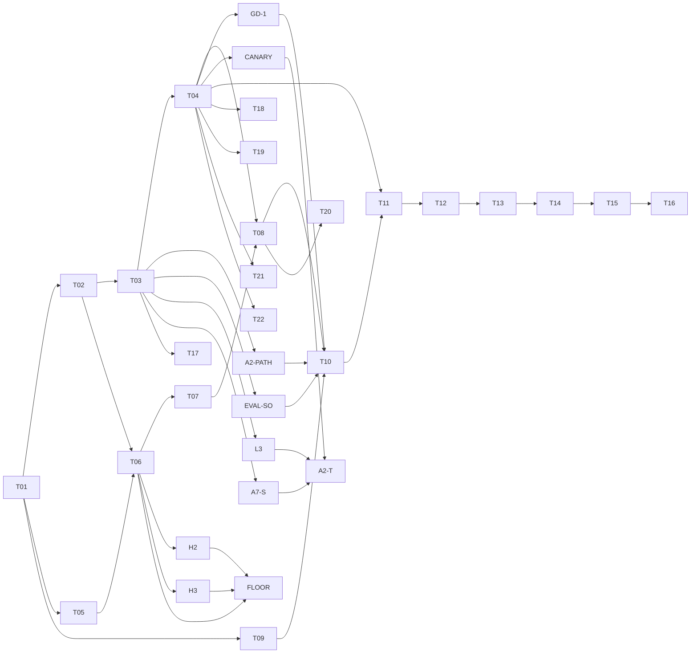

# Tasks: BlackDog (spec 001)

- Input: [spec.md](spec.md), [plan.md](plan.md), [data-model.md](data-model.md), [contracts/](contracts/)
- Mirror: [KANBAN.md](../../KANBAN.md) and the GitHub Project "FaustCoder". Task IDs match KANBAN.

Format: `- [ ] Txx [P?] [Story] Description`. `[P]` means it can run in parallel
with other `[P]` tasks once its dependencies are met. Every task lists
dependencies, acceptance evidence (OBSERVED from KANBAN), governing workflows
(copied from spec §16) and an evidence path (INFERRED). Every task also needs an
owner, inputs, outputs, failure disposition and evidence path before it starts
(spec §13).

Governing workflows for all implementation tasks: anti-slop-code,
production-systems, google-developer-style. State-machine tasks also follow
spec-kit; security-relevant tasks add ADVERSARY review.

## Phase 1: Setup

- [ ] T01 [Setup] Constitution and ADRs.
  - Depends on: none. Milestone: v0.1.
  - Acceptance: reviewed architectural decisions; ADR-0001 moves from PROPOSED to ACCEPTED.
  - Workflows: spec-kit, google-developer-style. Owner: FORGE, SCRIBE.
  - Evidence: `docs/adr/`, `.specify/memory/constitution.md`.

## Phase 2: Foundational (blocks every user story)

- [ ] T02 [Found] JSON schemas and immutable artifact store.
  - Depends on: T01. Milestone: v0.1.
  - Acceptance: schema validation and digest tests; store rejects payload mutation and parent cycles (constitution II).
  - Implements: [contracts/](contracts/), [data-model.md](data-model.md).
  - Workflows: anti-slop-code, production-systems. Evidence: `receipts/T02/` (INFERRED).
- [ ] T03 [Found] Sandboxed Faust compiler harness.
  - Depends on: T02. Milestone: v0.1.
  - Acceptance: reproducible compiler receipts (R-005); no network, bounded resources (R-013).
  - Amended 0.3.0 (ADR-0004): wrap libfaust from faustwasm 0.19.0 in a Node.js worker; cross-check with the native Faust 2.88.0 CLI; classify diagnostics.
  - Amended 0.3.4 (ADR-0006): the R-005 reward ladder is A1–A7 in the ADR. ADR-0006 is in force in reward code (`grade_receipt`, spec §23).
  - Workflows: production-systems, ADVERSARY review. Evidence: `receipts/T03/` (INFERRED).
- [ ] T04 [Found] DSP signal test harness.
  - Depends on: T03. Milestone: v0.1.
  - Acceptance: known-good and known-bad fixtures; legal delayed feedback passes (ADR-0001, V0.3).
  - Amended 0.3.0 (ADR-0004): offline render with faustwasm at 44.1 and 48 kHz; reference comparison in the style of Faust `tests/impulse-tests`; CPU only on promotion candidates.
  - Follow-up (N6, Danny yes 2026-10-17): `nonlinear-suite-v1` renders eight float32 stimuli at the 144000-frame floor. The signed sample check is the gate. THD+N, IMD and the Farina inverse filter are diagnostics. The suite is not in `REWARD_PROFILES`. TaskSpec `effect` is a closed enum; only `linear` and `time_invariant` are rewardable. `require_task_rewardable` is called by `dataset_reward_row` and `rl_batch` (D5). `nonlinear-suite-fallback-v1` is the four-stimulus fallback. x86 DSP-bank goldens live in `tests/fixtures/signal/`. `scripts/signal_cross_arch.py` compares them; the ARM side is pending on the DGX Spark.
  - Workflows: anti-slop-code, production-systems. Evidence: `faustcoder/signal.py`, `docs/runbooks/signal-harness.md`; local receipts under the artifact store (gitignored).

## Phase 3: User story J-04, maintainer ingests examples through to a release decision

Implements the dataset machine (spec §7.1) and training machine (spec §7.3).

- [ ] T05 [P] [J-04] Source rights inventory.
  - Depends on: T01. Milestone: v0.1.
  - Acceptance: provenance and exclusion receipts; implements `rights_cleared` and `rights_rejected` transitions.
  - Workflows: production-systems, ADVERSARY review (poisoning, licensing). Evidence: `corpus/` records, receipts.
- [ ] T06 [J-04] Normalization and dedup.
  - Depends on: T05, T02. Milestone: v0.2.
  - Acceptance: deterministic snapshot; implements `normalized` and `dedup_passed` transitions.
  - Proposed (D-013, Danny yes 2026-10-17 1:04 PM PT): an n-gram or AST near-duplicate filter on generated `.dsp` against the training-only set, including vendored near-copies of `faust/examples`. The threshold is not set. This is a requirement to carry into the task, not an implementation in T05.
  - Amended 0.3.5 (Q3): dedup uses provisional `TOKEN_FLOOR=40`. P0 exits only if that floor is accepted by the Q3 protocol or marked provisional with a recorded leakage caveat. The protocol runs after H2 and H3.
  - Workflows: anti-slop-code, production-systems.
- [ ] T07 [J-04] Split freeze.
  - Depends on: T06. Milestone: v0.2.
  - Acceptance: leakage checks and signed split manifest; implements `split_frozen` (R-003).
  - Proposed (D-013): the same near-duplicate filter is a split gate, so training-only and impulse-test families cannot land in eval or the sealed holdout. The threshold is not set.
  - Amended 0.3.5 (Q3, Q4): a freeze on the provisional floor records a leakage caveat and a scheduled re-check. Leaked items are removed and the removal is logged. Holdout novelty is re-checked once the floor is accepted, before any P3 exit claim rests on the holdout.
  - Workflows: production-systems.
- [ ] T08 [J-04] Baseline models.
  - Depends on: T04, T07. Milestone: v0.2.
  - Acceptance: frozen baseline measurements (R-007); input to D-002 and D-005.
  - Workflows: production-systems.
- [ ] T09 [P] [J-04] DGX Spark feasibility study.
  - Depends on: T01. Milestone: v0.2.
  - Acceptance: for v0.2, cited external DGX Spark benchmarks plus a per-machine environment fingerprint receipt (R-001, amended 0.3.1); implements `env_verified`. On-hardware throughput is deferred to T10 on the dedicated, cleared Spark.
  - Workflows: production-systems.
- [ ] T10 [J-04] Training path P1 to P3 (ADR-0002).
  - Depends on: T08, T09, GD-1, A2-PATH, EVAL-SO. Milestone: v0.2 (P1, P2) and v0.3 (P3).
  - Acceptance: one pinned, reproducible `TrainingRun` per phase with its exit-gate result (R-008, R-009, R-015); P1 may be a recorded skip; implements `run_started` to `COMPLETED`.
  - Sub-steps: P1 continued pretraining or skip; P2 SFT on validated pairs; P3 compiler-feedback RL (R-016).
  - Amended 0.3.5 (Q4): ADR-0002 is accepted in full (Jev's default; Danny may still choose P3 PROPOSED). P3 reward is the ADR-0006 grader with the Q1 binary ruling, whole-group drop, and A2-T as the only auto-attribution path. The P3 exit gate requires the graded/ungraded split, the A7 quarantine rate and the group-drop rate within pre-registered limits, and no frozen auto-attribution signature at exit. Only the ~5M-token CPT-skip threshold is ratified. The 2-point loss and compile@10 noise are paired-CI tests. GD-1 is a prerequisite, not a follow-on.
  - Workflows: anti-slop-code, production-systems.
- [ ] T11 [J-04] Independent DSP evaluation.
  - Depends on: T10, T04. Milestone: v0.3.
  - Acceptance: paired metrics and regression results with confidence intervals (§9, R-011).
  - Workflows: production-systems.
- [ ] T12 [J-04] Promotion decision.
  - Depends on: T11. Milestone: v0.3.
  - Acceptance: human review and DecisionRecord; implements `admit` and `reject`.
  - Workflows: spec-kit, google-developer-style.

## Phase 3b: Target lanes (ADD 0.3.0, ADR-0004)

Each lane emits a `TargetReceipt` and has known-good and known-bad fixtures.
Lanes run in parallel with T10.

- [ ] T17 [P] [Lane] Language-backend lane (R-024).
  - Depends on: T03. Milestone: v0.3.
  - Acceptance: `-lang cpp`, `c`, `rust` and `cmajor` output compiles in pinned toolchains, and compiled runs match the host render.
  - Workflows: anti-slop-code, production-systems.
- [ ] T18 [P] [Lane] Plugin lane (R-023, D-012).
  - Depends on: T04. Milestone: v0.3.
  - Acceptance: CLAP (`faust2clap`), VST3 (clap-wrapper) and LV2 (`faust2lv2`) build in a Linux container; `clap-validator`, `pluginval` and `lv2lint` pass on known-good fixtures and fail on known-bad ones; parameter-map check passes. AU deferred to macOS CI.
  - Workflows: anti-slop-code, production-systems, ADVERSARY review (container and SDK supply chain).
- [ ] T19 [P] [Lane] Embedded lane (R-019, D-008).
  - Depends on: T04. Milestone: v0.3.
  - Acceptance: `faust2daisy` and `faust2teensy` builds with pinned SDKs; flash and RAM budgets from linker maps; CPU proxy budget; real-time checks (R-021). No board purchase.
  - Workflows: anti-slop-code, production-systems.
- [ ] T20 [Lane] Remix tasks and novelty metric (R-020, D-010).
  - Depends on: T08. Milestone: v0.3.
  - Acceptance: remix tasks in the dev suite with two or more source demos; novelty reported as a dev metric; correctness uses the normal gates.
  - Workflows: anti-slop-code.
- [ ] T21 [P] [Lane] Real-time safety checks (R-021).
  - Depends on: T04. Milestone: v0.3.
  - Acceptance: fixtures with NaN, denormals, unbounded delay memory and allocation in the callback are rejected on every lane.
  - Workflows: anti-slop-code, production-systems.
- [ ] T22 [P] [Lane] FPGA F0 spike (R-022, D-009).
  - Depends on: T04. Milestone: v0.5-fpga. Timebox: 1 week.
  - Acceptance: DecisionRecord comparing three lowerings for a one-pole low-pass and a sine oscillator: Verilator sim vs Faust render, Yosys and nextpnr results for iCE40 and ECP5, audio-rate throughput.
  - Workflows: production-systems, spec-kit (DecisionRecord).

## Phase 4: User stories J-01, J-02, J-03 (generate, repair, optimize)

Implements the candidate machine (spec §7.2).

- [ ] T13 [J-01, J-02, J-03] Local serving API.
  - Depends on: T12. Milestone: v0.4.
  - Acceptance: contract tests against [contracts/inference-api.md](contracts/inference-api.md); bounded repair (R-012).
  - Workflows: anti-slop-code, production-systems, ADVERSARY review.
- [ ] T14 [J-01, J-02, J-03] IDE integration.
  - Depends on: T13. Milestone: v0.4.
  - Acceptance: end-to-end journey tests for J-01 to J-03 on Spark with reproducible receipts.
  - Workflows: anti-slop-code, production-systems.

## Phase 5: Polish and release

Implements the release machine (spec §7.4).

- [ ] T15 Security and quality review.
  - Depends on: T14. Milestone: v1.0.
  - Acceptance: independent audit.
  - Workflows: ADVERSARY, production-systems.
- [ ] T16 Release.
  - Depends on: T15. Milestone: v1.0.
  - Acceptance: signed release manifest and rollback test; full §15 gate.
  - Workflows: production-systems, google-developer-style (model and data cards).

## Follow-ups 0.3.5 (Jev, 2026-10-17 7:40 PM PT)

Mirror of the KANBAN rows. The rulings are the verbatim blocks in spec §24.
These tasks are the implementation. This record does not change code.

- [x] L1 [Found] RangeError is stack overflow only for `Maximum call stack size exceeded`.
  - Depends on: T03. Milestone: v0.3. Done in #49 (`f0fcdf9`), on main with #46 (`42ee1e4`).
  - Acceptance: landed. Prerequisite for A2-T leaving shadow.
  - Workflows: anti-slop-code, production-systems.
- [x] L2 [Found] Line-start matching on the failing stage; split on `\n` only.
  - Depends on: T03. Milestone: v0.3. Done in #49. This is the r5 L2 fix Jev cited.
  - Acceptance: landed. `_compile_stack_line` splits on `\n` only.
  - Workflows: anti-slop-code, production-systems.
- [ ] L3 [Found] Rerun hooks for exits 124 and 125 on the compile and render stages (r5 L3).
  - Depends on: T03. Milestone: v0.3.
  - Acceptance: the hooks feed A2-T in shadow only. Not quarantine-age tracking, and not a substitute for it.
  - Workflows: production-systems.
- [ ] A7-S [J-04] Per-signature attribution-rate tracking.
  - Depends on: T03. Milestone: v0.3. Prerequisite of A2-T.
  - Acceptance: provisional thresholds 20% share, 2× rise, 500-sample window, distinct from A7. `resolved_by: "auto"` and stored evidence. A gold-canary crash freezes its signature. Reviewed against shadow data before A2-T goes live.
  - Workflows: production-systems.
- [ ] CANARY [J-04] Scheduled gold canary: dev-suite references, cleared-corpus sample, SFT targets, run on a schedule.
  - Depends on: T04. Milestone: v0.3. Prerequisite of A2-T.
  - Acceptance: the canary runs on a schedule and its result is recorded. A2-T goes live only while it is clean. Any crash there freezes its signature through A7-S.
  - Workflows: production-systems.
- [ ] A2-T [J-04] A2-T shadow mode, then live auto-attribution.
  - Depends on: L1, L2, L3, A7-S, CANARY. Milestone: v0.3.
  - Acceptance: shadow computes and logs attributions; humans triage. Shadow mode runs on a separate path that never grades: it may rerun and log attributions, but its output never reaches `reward_value` or a receipt. That path is not a training caller, so needing reruns in shadow does not conflict with A2-PATH. Leaves shadow only when L1–L3 have landed, agreement is on a sample fixed before shadow starts, the gold canary (dev-suite references, cleared-corpus sample, SFT targets) is clean and any crash there freezes its signature, A7-S thresholds are reviewed, and the go-live is recorded. Crash rows below ~0.1% of samples keep auto-attribution off entirely. That rate is a reason to stay off, never a reason to go live.
  - Workflows: production-systems, ADVERSARY review.
- [ ] A2-PATH [J-04] Training callers must not supply the replaced path.
  - Depends on: T03. Milestone: v0.3. Prerequisite of T10.
  - Acceptance: until A2-T is live, no training caller supplies `rerun` or `known_good`. `runtime_stack_overflow` and `wasm_trap` stay ungraded without a matching native Faust 2.88.0 failure. The source-class list alone suffices only for a line-start Faust `ERROR` other than `ERROR : stack overflow` (plain or `in eval`; see EVAL-SO), a source over 1 MiB, and a remote import. Shadow mode runs on a separate path that never grades: it may rerun and log attributions, but its output never reaches `reward_value` or a receipt. That path is not a training caller, so needing reruns in shadow does not conflict with A2-PATH.
  - Workflows: production-systems, ADVERSARY review.
- [ ] EVAL-SO [Found] Grader must not tag either stack-overflow line as source without a native match.
  - Depends on: T03. Milestone: v0.3. Noted after #46. Prerequisite of T10.
  - Acceptance: the grader no longer tags either line as source without the Faust 2.88.0 native match. That is the A2-PATH requirement for the plain line-start `ERROR : stack overflow` and for `ERROR : stack overflow in eval`.
  - Workflows: production-systems.
- [ ] GD-1 [J-04] GRPO whole-group drop (Q1).
  - Depends on: T04. Milestone: v0.3. Prerequisite of T10.
  - Acceptance: a group with a quarantined member is dropped whole, not masked. Rows are held only for triage and receipts and never re-enter. Rate logged per checkpoint and per prompt. The halt pauses P3 instead of resampling. A prompt dropped repeatedly goes to human triage.
  - Workflows: production-systems.
- [ ] H2 [J-04] H2 (brief: canonical ID/NUM shingle stream; ADVERSARY PR39 r6 adds: keep `lib.fn` qualified names, same 1/2 rule). A second shingle stream with identifiers → `ID` and numbers → `NUM`. The `STR` collapse applies only on this canonical stream. That stream is an extra stream combined with the raw stream by OR and never replaces the raw stream. ADVERSARY r6 addition; not ruled by Jev: `lib.fn`, the 1/2 rule, and the `STR` collapse.
  - Depends on: T06. Milestone: v0.2. Prerequisite of FLOOR.
  - Acceptance: the r6 H2 probe at k = 5, 6, 8 (probe39r6.py 2b) is quarantined. k = 7 was never run. Jev's output cites H2 and H3 from the brief and does not rule the r6 additions.
  - Workflows: production-systems.
- [ ] H3 [J-04] H3 (brief: NFKC and drop Cf/Cc). Unicode normalization before tokenizing. The brief's H3 case is the U+200B evasion. ADVERSARY r6 addition; not ruled by Jev: the literal-insertion probe is not an H3 requirement, and the `STR` collapse is not H3.
  - Depends on: T06. Milestone: v0.2. Prerequisite of FLOOR.
  - Acceptance: the r6 U+200B probe is quarantined. The r6 literal-insertion probe (rev 0.367) is reported and is not an H3 gate, because collapsing to `STR` does not restore 5-gram overlap.
  - Workflows: production-systems.
- [ ] FLOOR [J-04] TOKEN_FLOOR measurement protocol (Q3).
  - Depends on: T06, H2, H3. Milestone: v0.2.
  - Acceptance: real slicer and real cleared hosts; H1-style split of one rejected file across 3 or more cleared files; per-bucket recall with Wilson intervals and hand-labelled FP cost. Danny sets the recall lower bound, zero reject-class copies left in cleared, and the FP blob budget before the run. Spans under 15 tokens stay on exact hash on the ID/NUM stream, and that check needs the brief's idioms allowlisted pairing, or short idioms will be over-flagged. The shipped dedup must use the same streams this protocol measures: the raw stream, plus the H2 canonical stream combined with it by OR. The `STR` collapse is only on that canonical stream and never replaces the raw stream. If only the 20–39 bucket fails at 40, a function-unit-only lower floor is allowed and whole files keep 40. ADVERSARY confirms containment and allowlist fixes on the shipping slicer path. SemDeDup-style similarity is advisory for T07 only and never a clearance criterion.
  - Workflows: production-systems, ADVERSARY review.

## Dependency graph

Parallel starts after T01: T02, T05 and T09. Lanes T17 to T19, T21 and T22 run in parallel with T10. From 0.3.5: GD-1 precedes T10, and A7-S precedes A2-T.
