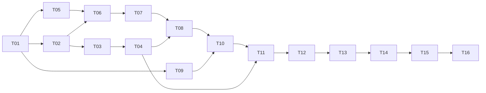

# Tasks: FaustCoder (spec 001)

- Input: [spec.md](spec.md), [plan.md](plan.md), [data-model.md](data-model.md), [contracts/](contracts/)
- Mirror: [KANBAN.md](../../KANBAN.md) and the GitHub Project "FaustCoder". Task IDs match KANBAN.

Format: `- [ ] Txx [P?] [Story] Description`. `[P]` means it can run in parallel
with other `[P]` tasks once its dependencies are met. Every task lists
dependencies, acceptance evidence (OBSERVED from KANBAN), governing workflows
(copied from spec §16) and an evidence path (INFERRED). Every task also needs an
owner, inputs, outputs, failure disposition and evidence path before it starts
(spec §13).

Governing workflows for all implementation tasks: anti-slop-code,
production-systems, google-developer-style. State-machine tasks also follow
spec-kit; security-relevant tasks add ADVERSARY review.

## Phase 1: Setup

- [ ] T01 [Setup] Constitution and ADRs.
  - Depends on: none. Milestone: v0.1.
  - Acceptance: reviewed architectural decisions; ADR-0001 moves from PROPOSED to ACCEPTED.
  - Workflows: spec-kit, google-developer-style. Owner: FORGE, SCRIBE.
  - Evidence: `docs/adr/`, `.specify/memory/constitution.md`.

## Phase 2: Foundational (blocks every user story)

- [ ] T02 [Found] JSON schemas and immutable artifact store.
  - Depends on: T01. Milestone: v0.1.
  - Acceptance: schema validation and digest tests; store rejects payload mutation and parent cycles (constitution II).
  - Implements: [contracts/](contracts/), [data-model.md](data-model.md).
  - Workflows: anti-slop-code, production-systems. Evidence: `receipts/T02/` (INFERRED).
- [ ] T03 [Found] Sandboxed Faust compiler harness.
  - Depends on: T02. Milestone: v0.1.
  - Acceptance: reproducible compiler receipts (R-005); no network, bounded resources (R-013).
  - Workflows: production-systems, ADVERSARY review. Evidence: `receipts/T03/` (INFERRED).
- [ ] T04 [Found] DSP signal test harness.
  - Depends on: T03. Milestone: v0.1.
  - Acceptance: known-good and known-bad fixtures; legal delayed feedback passes (ADR-0001, V0.3).
  - Workflows: anti-slop-code, production-systems. Evidence: `receipts/T04/` (INFERRED).

## Phase 3: User story J-04, maintainer ingests examples through to a release decision

Implements the dataset machine (spec §7.1) and training machine (spec §7.3).

- [ ] T05 [P] [J-04] Source rights inventory.
  - Depends on: T01. Milestone: v0.1.
  - Acceptance: provenance and exclusion receipts; implements `rights_cleared` and `rights_rejected` transitions.
  - Workflows: production-systems, ADVERSARY review (poisoning, licensing). Evidence: `corpus/` records, receipts.
- [ ] T06 [J-04] Normalization and dedup.
  - Depends on: T05, T02. Milestone: v0.2.
  - Acceptance: deterministic snapshot; implements `normalized` and `dedup_passed` transitions.
  - Workflows: anti-slop-code, production-systems.
- [ ] T07 [J-04] Split freeze.
  - Depends on: T06. Milestone: v0.2.
  - Acceptance: leakage checks and signed split manifest; implements `split_frozen` (R-003).
  - Workflows: production-systems.
- [ ] T08 [J-04] Baseline models.
  - Depends on: T04, T07. Milestone: v0.2.
  - Acceptance: frozen baseline measurements (R-007); input to D-002 and D-005.
  - Workflows: production-systems.
- [ ] T09 [P] [J-04] DGX Spark feasibility study.
  - Depends on: T01. Milestone: v0.2.
  - Acceptance: ARM64/Blackwell throughput and memory receipts (R-001); implements `env_verified`.
  - Workflows: production-systems.
- [ ] T10 [J-04] LoRA training.
  - Depends on: T08, T09. Milestone: v0.2.
  - Acceptance: pinned reproducible training run (R-008, R-009); implements `run_started` to `COMPLETED`.
  - Workflows: anti-slop-code, production-systems.
- [ ] T11 [J-04] Independent DSP evaluation.
  - Depends on: T10, T04. Milestone: v0.3.
  - Acceptance: paired metrics and regression results with confidence intervals (§9, R-011).
  - Workflows: production-systems.
- [ ] T12 [J-04] Promotion decision.
  - Depends on: T11. Milestone: v0.3.
  - Acceptance: human review and DecisionRecord; implements `admit` and `reject`.
  - Workflows: spec-kit, google-developer-style.

## Phase 4: User stories J-01, J-02, J-03 (generate, repair, optimize)

Implements the candidate machine (spec §7.2).

- [ ] T13 [J-01, J-02, J-03] Local serving API.
  - Depends on: T12. Milestone: v0.4.
  - Acceptance: contract tests against [contracts/inference-api.md](contracts/inference-api.md); bounded repair (R-012).
  - Workflows: anti-slop-code, production-systems, ADVERSARY review.
- [ ] T14 [J-01, J-02, J-03] IDE integration.
  - Depends on: T13. Milestone: v0.4.
  - Acceptance: end-to-end journey tests for J-01 to J-03 on Spark with reproducible receipts.
  - Workflows: anti-slop-code, production-systems.

## Phase 5: Polish and release

Implements the release machine (spec §7.4).

- [ ] T15 Security and quality review.
  - Depends on: T14. Milestone: v1.0.
  - Acceptance: independent audit.
  - Workflows: ADVERSARY, production-systems.
- [ ] T16 Release.
  - Depends on: T15. Milestone: v1.0.
  - Acceptance: signed release manifest and rollback test; full §15 gate.
  - Workflows: production-systems, google-developer-style (model and data cards).

## Dependency graph

Parallel starts after T01: T02, T05 and T09.
